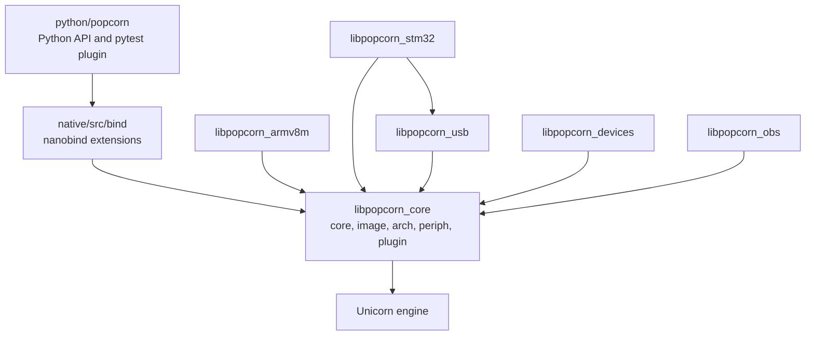

# Architecture

popcorn is a Python API over a native core that runs the firmware on a pinned Unicorn engine.

## Native libraries

`pcons-build.py` builds one shared library per area, `build/popcorn/libpopcorn_<name>.so`, and
a static twin of each for white-box tests and the build-time tools. The areas are:

| Library | Sources | Holds |
|---|---|---|
| `core` | `native/src/core`, `image`, the generic part of `arch`, the peripheral framework of `periph`, `plugin` | machine, clock, scheduler, host, system, memory map, images, model interfaces, plugin loader |
| `armv8m` | `native/src/arch/armv8m` | the Armv8-M architecture module |
| `usb` | `native/src/periph/usb` | the virtual USB host and the CDC ACM, HID and UAC2 functions |
| `stm32` | `native/src/periph/stm32` | the STM32 peripheral models |
| `devices` | `native/src/periph/devices` | bus devices such as the AT25SF NOR flash and the I2C EEPROM |
| `obs` | `native/src/obs` | trace and coverage file formats, `.pctr`, `.pcov`, lcov and drcov |

`popcorn_build/layering.py` fixes which library may include which. `core` includes only itself.
`armv8m`, `devices` and `obs` include `core`. `stm32` includes `core` and `usb`. A source file
belongs to exactly one library, extension or tool, and configure fails otherwise. The
`layering` stage of `pcons run check` checks every `#include`.

## Python extensions

The sources in `native/src/bind` build the `_core` extension, the nanobind bridge to the core
library. `native/src/obs` has its own extension, `_obs`, and the devices have
`popcorn.devices._native`. The Python package in `python/popcorn` wraps them. Private modules
start with an underscore and the public names are the `__all__` of `popcorn/__init__.py`.

## What a machine owns

`core::machine` is one emulated MCU. It owns the Unicorn engine, one host buffer per RAM and
flash region, the clock and its driver, the event scheduler, the architecture module and the
loaded images. For each peripheral of the part description it owns a register file, the
interrupt and DMA request lines, an event port and a model. It is not thread safe. One thread
drives it, see [Threads](threads.md).

## Third-party code

- Unicorn is the submodule `third_party/unicorn`, a fork on the `popcorn` branch. The build
  compiles it with CMake as a static library and reads its commit from git.
- reflex is the submodule `third_party/reflex`. popcorn uses its C++26 reflection helpers for
  enum formatting, serialization and Python binding.
- nanobind, robin-map and doctest come from `deps.toml`, fetched at configure time with a
  checksum. The test firmware sources are fetched only when the cross toolchain is present.

## Where to read next

- [Run loop](run_loop.md) for how a slice executes.
- [Systems](systems.md) for several machines on one clock.
- [Peripherals](peripherals.md) for models and resets.
- [Descriptions](descriptions.md) and [Images](images.md) for the data a machine is built from.
