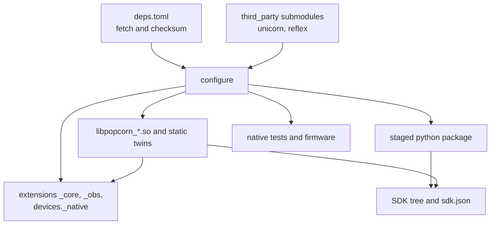

# Build

popcorn builds with pcons, a Python build system that generates Ninja files. The entry point is
`pcons-build.py` at the repository root. It reads helpers from `popcorn_build/`.

```sh
uv run pcons -B build -j10
```

## Requirements

`popcorn_build/config.py` refuses to configure without these:

- g++ 16.1 or later as `g++`, using `-std=gnu++26 -freflection -fcontracts` and
  `-Werror` with a fixed set of warnings.
- cmake, to build Unicorn, and ninja.
- Python 3.14 with its development headers.

arm-none-eabi-gcc is optional. Without it the tests and examples use their committed
prebuilt ELFs.

## Variants

`--variant` picks `release`, the default, `debug`, `asan` or `tsan`. The asan and tsan variants
compile with the sanitizer and build the native tests only: the Python extensions are skipped,
so the Python tests run in the release or debug build. An LTO build is on by default for a
wheel build only, `POPCORN_ENABLE_LTO` switches it.

## The version

The version comes from the git tag through setuptools_scm, with `version_scheme =
"guess-next-dev"` and `local_scheme = "no-local-version"` under `[tool.setuptools_scm]`. A commit
tagged `v0.1.0` builds `0.1.0`. A later commit builds the next patch version with a dev segment
that counts the commits since the tag, `0.1.1.dev3`. The version has no local segment, so every
wheel is accepted by an index. Only tags of the form `v<version>` count, so tags such as
`fold-r12-pre` never reach the version (`[tool.setuptools_scm.tag]`). At a tagged commit, a
modified tracked file gives the next dev version, `0.1.1.dev0`. Untracked files leave the version
unchanged.

`popcorn_build.version.popcorn_version` computes it for the wheel and sdist metadata, the SDK
header `POPCORN_VERSION_STRING`, the build info and `pcons-build.py`. `python -m
popcorn_build.version` prints it. The build backend `popcorn_build.backend` hands it to
`pcons.pyproject`, which reads a static `[project].version`.

- `SETUPTOOLS_SCM_PRETEND_VERSION` sets the version for a tree without git metadata. The Docker
  build passes the version the workflow derived from the tags this way.
- An sdist carries its version in `PKG-INFO`, so a wheel built from it has the same version and
  needs no git.
- `uv sync` rebuilds the editable install after a new commit or tag, through `cache-keys` in
  `[tool.uv]`.

A new commit changes the version string and so the plugin ABI tag: a plugin built before it is
rebuilt or refused, like one built against other headers.

## What gets built



- The shared libraries and their static twins, see [Architecture](architecture.md). A target
  that reaches both flavours of a library fails the build, `check_core_links` enforces it.
- The extensions and their `.pyi` stubs, generated with nanobind's stub generator into
  `build/popcorn`. The staged Python package lands in the same directory, so `build/popcorn` is
  the importable package. Documentation tools read it from there.
- `popcorn-describe-schema` and `popcorn-regs-gen`, build-time tools that write the part
  description schema and the Arm register definitions.
- The plugin SDK under `popcorn/sdk/`: the public headers, the nanobind runtime archive and
  `sdk.json`, which names the compiler and flags a plugin must build with.
- With tests on, the native doctest programs, the header check and the test firmware. With
  examples on, each example's firmware.

## The ABI tag and the SDK digest

`popcorn_build/sdk.py` hashes the public headers under `native/include/popcorn` and every reflex
header they reach. The digest is the `;sdk` field of the plugin ABI tag, so a plugin built
against other headers is refused even when the version string is unchanged. The header list is
read when pcons configures, so a new header joins the digest at the next configure.

The digest covers each header's text after the compiler strips the comments. A directive line,
with its backslash continuations, keeps its ending newline and every other run of ASCII
whitespace, newlines included, is one space. The compiler runs
`g++ -fpreprocessed -dD -E -P -x c++ <header>`, which keeps directives and expands no macro or
include, so the text does not depend on include paths. The pcons build passes its C++ compiler to
`popcorn_build.sdk`, tests and direct callers use `g++` from `PATH`. A missing compiler, a failing
run or non-UTF-8 output stops the build with an error. Comments, doxygen blocks, indentation, line
breaks and blank lines do not reach the digest, so a documentation or clang-format edit keeps it
and keeps built plugins valid. Inline and template bodies, private members, default arguments,
macros, string literals and the spelling of operators and spaces count, so `a+b` and `a + b`
differ, `#define F(x)` and `#define F (x)` differ, and `#define A 1` followed by a line `B`
differs from `#define A 1 B`. Editing any of them changes the digest and makes dev plugins
rebuild. The compiler consumes `#pragma once`, `push_macro`, `pop_macro`, `GCC poison`,
`GCC system_header` and `GCC warning` under `-fpreprocessed`, so these pragmas are not in the
digest.

## Dependencies

`deps.toml` lists the sources that are fetched: URL, SHA-256, version and build mode. Fetching
goes through pcons' `fetch_package` and lands in `build/deps` with a description in
`build/pkg`. Unicorn and reflex are git submodules instead. Unicorn is built with CMake and
cached by its commit.

Two flags in an entry change when it is fetched:

- `firmware = true`: the package is used by test firmware only and is fetched only when
  arm-none-eabi-gcc is on PATH.
- `docs = true`: the package is used by the documentation build only. A configure never fetches
  it. The docs stage does.

## Firmware

`popcorn_build/firmware.py` builds the test firmware with the cross toolchain, or falls back to
the committed ELF in `prebuilt/`. When both exist, a
`firmware-check-<name>` target fails if the loadable content of the built ELF differs from the
committed one, so a source change that is not copied over is caught. The examples build the same
way with `popcorn_build/examples.py`, as an STM32 Cube project would.

## The documentation build

```sh
uv run pcons -B build
uv run python -m popcorn_build.docs
```

The reference reads the package from `build/popcorn`, so the native build comes first. The docs
stage then:

1. Regenerates the support pages into `docs/support/generated`.
2. Builds the SDK reference. Without doxygen on PATH it prints one warning, writes a stub page
   and fetches nothing, so it needs no network. With doxygen it first fetches the
   doxygen-awesome-css theme, which needs network access the first time. The download is kept
   in `build/deps`, so a later run works offline. If the fetch fails it prints one warning and
   doxygen keeps its default style. Then it runs doxygen on the SDK headers and writes the HTML
   to `docs/reference/sdk/api`. Any doxygen warning, an undocumented declaration included, fails
   the stage.
3. Runs `zensical build --strict` and fails on a griffe docstring warning.

The documentation dependencies are the `docs` dependency group of `pyproject.toml`.

## Build variables

The package build, `uv sync` or `pip install`, compiles the package only: `[tool.pcons]` in
`pyproject.toml` sets both variables below to `OFF`. A pcons build defaults both to `ON`, but a
build directory keeps the values it was last configured with, and the package build configures
`build/` with both `OFF`.

| Variable | Default | `OFF` skips |
| --- | --- | --- |
| `POPCORN_BUILD_TESTS` | `ON` | native tests, test firmware, the header check, `popcorn_testing._smoke`, the firmware packages of `deps.toml`, but doctest is still fetched |
| `POPCORN_BUILD_EXAMPLES` | `ON` | example firmware, and the firmware packages when tests are off too |

Each takes `ON`, `OFF`, `1` or `0`, in any case. Anything else stops the configure.

pcons keeps a `KEY=value` variable in the build directory, and the package build uses `build/`.
After a `uv sync`, or any `uv run` that re-syncs the editable package, pass both `ON` once to get
the tests and examples back:

```sh
uv run --no-sync pcons -B build POPCORN_BUILD_TESTS=ON POPCORN_BUILD_EXAMPLES=ON
```

`pcons run check` passes both `ON` itself.

The `release` variant, the default, builds Unicorn with `UC_LOAD_HELPER_NO_STACK_PROTECTOR`.
It drops the stack protector from Unicorn's guest load helper. The `debug`, `asan` and `tsan` variants and a Unicorn build outside popcorn keep it.
