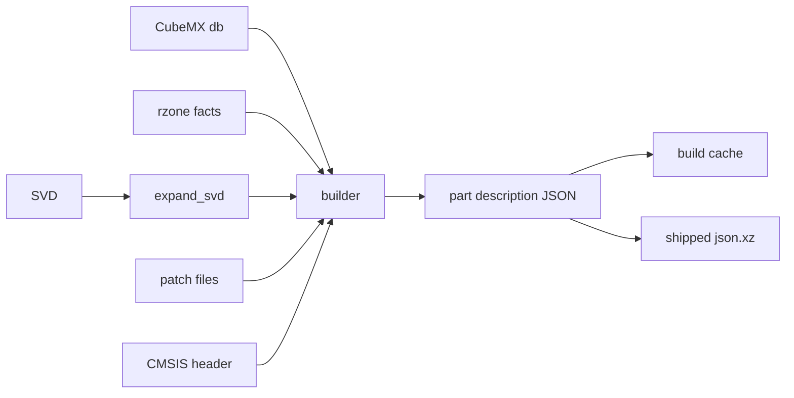

# Descriptions

A part description says what a part is: its core, memory regions, peripherals with registers
and fields, interrupts and GPIO alternate functions. The machine is built from it and never
from ad-hoc arguments.

## The data

The native type is `part_description` in `native/include/popcorn/core/description.hpp`. It
comes with `parse_description`, `load_description`, `dump_description`, `description_digest`
and a JSON Schema from `description_json_schema`. `description_schema_version` is part of the
data. The JSON Schema is committed as `data/schema/part_description.schema.json` and
`python/popcorn/stm32/description/_codegen.py` generates the Python dataclasses of `_model.py`
from it. Do not edit `_model.py` by hand. `popcorn_build/schema.py` builds the `popcorn-describe-schema`
program and rewrites the schema from the native type.

## The pipeline



The modules are in `python/popcorn/stm32/description`:

- `_sources.py` finds the SVD, the CubeMX db, the rzone facts, the GPIO modes file, the CMSIS
  device header and the patch files of a part.
- `_svd.py` expands an SVD: `derivedFrom`, `dim`, clusters and property inheritance. It is a
  pure function of the file bytes.
- `_cubemx.py` reads the part lookup, the memory regions and processor facts, the IP instance
  join and the GPIO alternate functions.
- `_patches.py` applies popcorn's own TOML patches: peripheral drops, fields, field drops, cross
  rules, aliases, IP renames, IRQ changes, GPIO alternate function drops, core overrides, added
  registers and regions, and the device signature. The patches are in the `patches` directory.
- `_builder.py` assembles the description: expand the SVD, read the db and rzone, apply every
  patch, strip the peripheral prefix of register names, build the IRQ table, then assemble the
  core, regions and peripherals.
- `rzone` holds popcorn's own facts for memory regions and core counts, written from the
  reference manual and the datasheet.

The built description is cached as JSON under `$XDG_CACHE_HOME/popcorn/mcu`, keyed by the part,
the core, the schema version, the generator string and the digests of the resolved sources
in `_cache.py`.

## Alternate function drops

The CubeMX GPIO modes file can list an alternate function a part cannot route. A patch removes
it with an `[alternates]` table:

```toml
[alternates]
drop = [
  { peripheral = "GPIOH", pin = 2, af = 5, signal = "SPI5_SCK", source = "datasheet Table n" },
]
```

Each rule takes the port in `peripheral`, the `pin` and `af` numbers from 0 to 15, the `signal`
name and a non-empty `source` naming the document that justifies the drop. The entry must exist
on the port and no rule may repeat it, otherwise the build raises `DescriptionError` with the
rule's index. The builder applies the rules after it reads the CubeMX modes, validates all of
them before removing any, and counts the drops in the patch report.

## Field drops

An SVD can describe fields a part does not implement, such as the per-pin fields of pins a port
lacks. A `[[fields]]` rule with `drop = true` removes them:

```toml
[[fields]]
instances = ["GPIOI"]
registers = ["GPIOI_MODER"]
fields = ["MODE12", "MODE13", "MODE14", "MODE15"]
drop = true
source = "silicon read-back: GPIOI_MODER keeps 0x00FFFFFF of 0xFFFFFFFF"
```

The rule takes the usual `ip` or `instances` selector, `registers` with an optional `each`
range, the `fields` and a non-empty `source`. It carries no `width`, `on_write` or `on_read`.
An `ip` selector picks the peripherals of that IP that are not aliases, `instances` must name
such peripherals. Each named register and field must exist and no rule may drop a field twice.
Otherwise the build raises `DescriptionError` with the rule's index. The fields leave the named
peripheral and each of its aliases, and a later rule naming them fails as naming an unknown
field. The patch report counts the drops in `fields_dropped`.

## Field renames

Two families can spell one field differently in their SVDs, such as the high bit of the timer
slave mode. A `[[fields]]` rule with `rename` gives the SVD field the spelling the model looks up:

```toml
[[fields]]
instances = ["TIM2"]
registers = ["TIM2_SMCR"]
rename = { SMS_2 = "SMS_1", TS_2 = "TS_1" }
source = "RM0481 Rev 5, 44.5.3: the SVD spells the SMCR bits as SMS_2 and TS_2"
```

`rename` maps each old name to its new one. The rule takes the usual selector, `registers` with an
optional `each` range and a non-empty `source`. It carries no `fields`, `drop`, `width`,
`on_write` or `on_read`. An `ip` selector picks the peripherals of that IP that are not aliases,
`instances` must name such peripherals. The build raises `DescriptionError` with the rule's index
when a register or a field is unknown, when the new name is already a field of the register, when
a rule renames a field an earlier rule renamed, or when the rule names no field. The new spelling
applies to the named peripheral and each of its aliases, and a later rule names it. The patch
report counts the renames in `fields_renamed`.

## Field adds

Silicon can hold a field the SVD omits. A `[[fields]]` rule with `add` puts one field into an
existing register:

```toml
[[fields]]
instances = ["TIM15"]
registers = ["TIM15_SMCR"]
add = { name = "SMSPE", lsb = 24, width = 1, acc = "read_write", reset = 0 }
source = "Silicon read-back on an STM32H573: TIM15_SMCR written 0xFFFFFFFF reads 0x033100F7"
```

`add` holds the field `name`, its bit offset `lsb`, its `width`, its access `acc` and its `reset`
value. The reset value lands in the register's reset word and marks those bits as known. The rule
takes the usual selector, `registers` with an optional `each` range and a non-empty `source`. It
carries no `fields`, `drop`, `rename`, `width`, `on_write` or `on_read`. The field is added to
the named peripheral and each of its aliases, and a later rule names it. The build raises
`DescriptionError` with the rule's index when the register is unknown, when the name is already a
field of the register, when the bits overlap another field or leave the register, when the reset
value does not fit the width, or when an earlier rule added the same field. The patch report
counts the adds in `fields_added`.

## Shipped descriptions

A description can ship in the package as `<RefName>[-<core>].json.xz` under
`python/popcorn/stm32/data`. `_shipped.py` decompresses it on first use, with a hard limit on
the decompressed size. The lookup order of `popcorn.stm32.mcu(part)` is:

1. `<RefName>[-<core>].json`, uncompressed, in a directory of `POPCORN_STM32_DESCRIPTION_DIRS`,
   searched in order.
2. The shipped file, skipped when `svd`, `cubemx_db` or `cmsis_header` is passed or
   `POPCORN_STM32_BUILD` is `local`. Any other value of that variable raises an error.
3. A local build from ST's files, cached.

The [Install](../guide/install.md) page shows the same order from the user side.

`_golden.py` writes a canonical text dump of a description, one line per item. The dump and its
digest file make a change of a shipped description visible in review.

## Digests

`description_digest` is a SHA-256 of the description content. A snapshot stores it and checks it
on load, so a snapshot only loads into a machine built from the same description.
