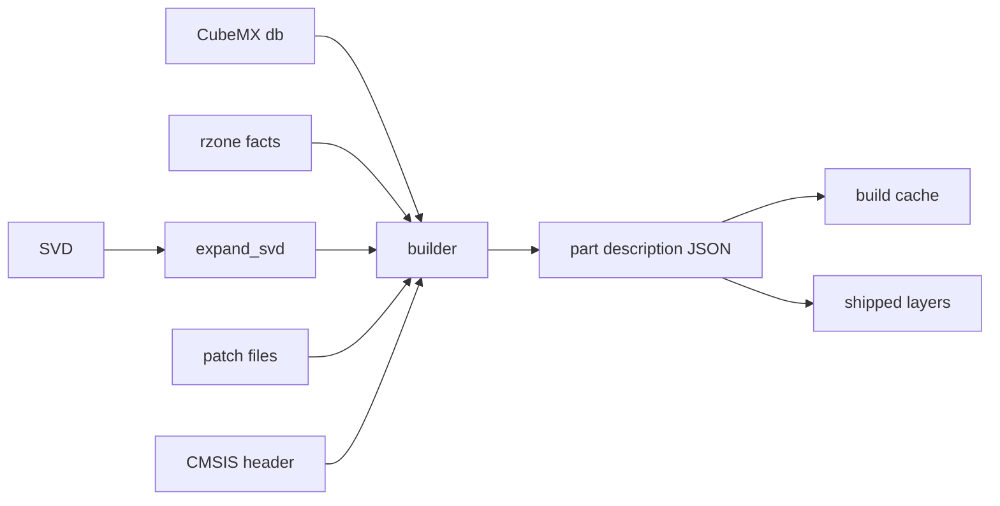

# Descriptions

A part description says what a part is: its core, memory regions, peripherals with registers
and fields, interrupts and GPIO alternate functions. The machine is built from it and never
from ad-hoc arguments.

## The data

The native type is `part_description` in `native/include/popcorn/core/description.hpp`. It
comes with `parse_description`, `load_description`, `dump_description`, `description_digest`
and a JSON Schema from `description_json_schema`. `description_schema_version` is part of the
data. The JSON Schema is committed as `data/schema/part_description.schema.json` and
`python/popcorn/stm32/description/_codegen.py` generates the Python dataclasses of `_model.py`
from it. Do not edit `_model.py` by hand. `popcorn_build/schema.py` builds the `popcorn-describe-schema`
program and rewrites the schema from the native type.

## The pipeline



The modules are in `python/popcorn/stm32/description`:

- `_sources.py` finds the SVD, the CubeMX db, the rzone facts, the GPIO modes file, the CMSIS
  device header and the patch files of a part.
- `_svd.py` expands an SVD: `derivedFrom`, `dim`, clusters and property inheritance. It is a
  pure function of the file bytes.
- `_cubemx.py` reads the part lookup, the memory regions and processor facts, the IP instance
  join and the GPIO alternate functions.
- `_patches.py` applies popcorn's own TOML patches: peripheral drops, fields, field drops, cross
  rules, aliases, IP renames, IRQ changes, GPIO alternate function drops, core overrides, added
  registers and regions, and the device signature. The patches are in the `patches` directory.
- `_builder.py` assembles the description: expand the SVD, read the db and rzone, apply every
  patch, strip the peripheral prefix of register names, build the IRQ table, then assemble the
  core, regions and peripherals.
- `rzone` holds popcorn's own facts for memory regions and core counts, written from the
  reference manual and the datasheet.

The built description is cached as JSON under `$XDG_CACHE_HOME/popcorn/mcu`, keyed by the part,
the core, the schema version, the generator string and the digests of the resolved sources
in `_cache.py`.

## Peripheral drops and renames

A `[peripherals]` table removes SVD peripherals or gives them another name:

```toml
[peripherals]
renames = { SEC_LPUART1 = "SEC_LPUART" }
source = "the SVD names the Secure window of LPUART SEC_LPUART1"
```

`drop` lists names to remove, `renames` maps an SVD name to its new name, and the table carries
at least one of them and a `source`. Both apply first, before the IP renames and the aliases, so
the `[aliases]` rule pairs a renamed `SEC_<name>` with the peripheral `<name>` and every later
rule names the new name. A renamed peripheral must exist and not be dropped, each name is
renamed once across the files, and the new name must be free, otherwise the build raises
`DescriptionError` keyed `peripherals.renames.<name>`. The patch report counts them in
`peripherals_dropped` and `peripherals_renamed`.

## Alternate function drops

The CubeMX GPIO modes file can list an alternate function a part cannot route. A patch removes
it with an `[alternates]` table:

```toml
[alternates]
drop = [
  { peripheral = "GPIOH", pin = 2, af = 5, signal = "SPI5_SCK", source = "datasheet Table n" },
]
```

Each rule takes the port in `peripheral`, the `pin` and `af` numbers from 0 to 15, the `signal`
name and a non-empty `source` naming the document that justifies the drop. The entry must exist
on the port and no rule may repeat it, otherwise the build raises `DescriptionError` with the
rule's index. The builder applies the rules after it reads the CubeMX modes, validates all of
them before removing any, and counts the drops in the patch report.

## Field drops

An SVD can describe fields a part does not implement, such as the per-pin fields of pins a port
lacks. A `[[fields]]` rule with `drop = true` removes them:

```toml
[[fields]]
instances = ["GPIOI"]
registers = ["GPIOI_MODER"]
fields = ["MODE12", "MODE13", "MODE14", "MODE15"]
drop = true
source = "silicon read-back: GPIOI_MODER keeps 0x00FFFFFF of 0xFFFFFFFF"
```

The rule takes the usual `ip` or `instances` selector, `registers` with an optional `each`
range, the `fields` and a non-empty `source`. It carries no `width`, `on_write`, `on_read` or `acc`.
An `ip` selector picks the peripherals of that IP that are not aliases, `instances` must name
such peripherals. Each named register and field must exist and no rule may drop a field twice.
Otherwise the build raises `DescriptionError` with the rule's index. The fields leave the named
peripheral and each of its aliases, and a later rule naming them fails as naming an unknown
field. The patch report counts the drops in `fields_dropped`.

## Field renames

Two families can spell one field differently in their SVDs, such as the high bit of the timer
slave mode. A `[[fields]]` rule with `rename` gives the SVD field the spelling the model looks up:

```toml
[[fields]]
instances = ["TIM2"]
registers = ["TIM2_SMCR"]
rename = { SMS_2 = "SMS_1", TS_2 = "TS_1" }
source = "RM0481 Rev 5, 44.5.3: the SVD spells the SMCR bits as SMS_2 and TS_2"
```

`rename` maps each old name to its new one. The rule takes the usual selector, `registers` with an
optional `each` range and a non-empty `source`. It carries no `fields`, `drop`, `width`,
`on_write`, `on_read` or `acc`. An `ip` selector picks the peripherals of that IP that are not aliases,
`instances` must name such peripherals. The build raises `DescriptionError` with the rule's index
when a register or a field is unknown, when the new name is already a field of the register, when
a rule renames a field an earlier rule renamed, or when the rule names no field. The new spelling
applies to the named peripheral and each of its aliases, and a later rule names it. The patch
report counts the renames in `fields_renamed`.

## Field adds

Silicon can hold a field the SVD omits. A `[[fields]]` rule with `add` puts one field into an
existing register:

```toml
[[fields]]
instances = ["TIM15"]
registers = ["TIM15_SMCR"]
add = { name = "SMSPE", lsb = 24, width = 1, acc = "read_write", reset = 0 }
source = "Silicon read-back on an STM32H573: TIM15_SMCR written 0xFFFFFFFF reads 0x033100F7"
```

`add` holds the field `name`, its bit offset `lsb`, its `width`, its access `acc` and its `reset`
value. The reset value lands in the register's reset word and marks those bits as known. The rule
takes the usual selector, `registers` with an optional `each` range and a non-empty `source`. It
carries no `fields`, `drop`, `rename`, `width`, `on_write`, `on_read` or `acc`. The field is added to
the named peripheral and each of its aliases, and a later rule names it. The build raises
`DescriptionError` with the rule's index when the register is unknown, when the name is already a
field of the register, when the bits overlap another field or leave the register, when the reset
value does not fit the width, or when an earlier rule added the same field. The patch report
counts the adds in `fields_added`.

## Field effects

An SVD can give a field the wrong size, write effect, read effect or access, such as the USB
endpoint registers of the STM32H5, whose toggle bits the SVD calls write-only. A `[[fields]]` rule
with any of `width`, `on_write`, `on_read` and `acc` sets them on existing fields:

```toml
[[fields]]
ip = "USB"
registers = ["USB_CHEP{n}R"]
each = { n = [0, 7] }
fields = ["STATTX", "DTOGTX", "STATRX", "DTOGRX"]
acc = "read_write"
on_write = "one_to_toggle"
source = "RM0481 Rev 5, 61.6.7: STATTX, DTOGTX, STATRX and DTOGRX are read and toggled by writing 1"
```

`width` is a bit count, `on_write`, `on_read` and `acc` take the spellings of the description
JSON, such as `zero_to_clear`, `clear` and `read_only`. The rule takes the usual selector,
`registers` with an optional `each` range, the `fields` and a non-empty `source`. An `ip` selector
picks the peripherals of that IP that are not aliases, `instances` must name such peripherals.
Each value applies to the named peripheral and each of its aliases, so a secure alias keeps the
fields of its base. The build raises `DescriptionError` with the rule's index when a register or a
field is unknown, when an earlier rule set the same property of the same field, or when a new
width leaves the register or overlaps another field. The patch report counts one
`fields_touched` per property, field and peripheral or alias it sets. `fields_dropped`,
`fields_renamed` and `fields_added` count each base field once, whatever its aliases.

## Shipped descriptions

Shipped descriptions live in `python/popcorn/stm32/data` as three kinds of xz-compressed JSON
layer, each `{"format": 1, ...}`:

| file | holds |
|---|---|
| `<family>.blocks.json.xz` | `blocks`: every `registers` plus `cross_rules` pair of the family's shipped parts, keyed by the SHA-256 of its canonical JSON |
| `<line>.line.json.xz` | the `reference` part's `schema_version`, `core`, `irqs` and peripheral headers in order |
| `<line>.parts.json.xz` | `line_sha256` of the decompressed line file and `parts`: one delta per shipped part, `<RefName>[-<core>]` |

The family is the RefName's first 7 characters plus `xx`, `STM32U5xx`, the line its first 9
plus `xx`, `STM32U575xx`. A header is a peripheral without `registers` and `cross_rules`, with
`"block": <key>` in their place. Two instances share a block only when their bytes are equal. A
delta holds the part's `part`, `generator`, `sources` and `regions`, the full header of every
instance that differs from the line's, and `schema_version`, `core` or `irqs` where they differ.
Every part of a line has the line's instances in the line's order.

`_layers.py` holds `factor`, which writes the layers of a set of descriptions, and `compose`, its
inverse, both pure functions. `compose_shipped` in `_shipped.py` composes a part into the same
JSON text `dump_json` writes, so the digest, snapshots and the native loader see the same
description. It refuses with `DescriptionError` naming the file: a layer of another `format`, a
`line_sha256` mismatch, a missing block or one whose bytes do not hash to its key, an unknown
instance, and a decompressed layer or composed description above `MAX_SHIPPED_BYTES`. The
composed size is counted before anything is built. On first use the composed text is cached as
`<cache>/shipped/<name>-<sha16>.json`, sha16 over the parts, line and family file bytes.

A part ships exactly when its golden file `tests/data/stm32/golden/<RefName>[-<core>].json`
exists. To add a part, write its golden, then ship:

```
uv run python -m popcorn.stm32.description golden STM32U575QGIx --update
uv run python -m popcorn.stm32.description ship STM32U575QGIx --pin-data <STM32_open_pin_data>
uv run python -m popcorn.stm32.description ship --pin-data <STM32_open_pin_data> --check
```

`ship` builds every golden part of each family it touches from `STM32_open_pin_data`, in a pool
of `-j` processes, and rewrites all layers of those families. A part named on the command line
selects its family, no part selects every family with a golden or a layer file. Each line's
reference is its part with the most bonded GPIO pins, then the largest flash, then the first
RefName in sorted order. Every file goes to a temporary name first and is renamed once all are
written. Then every layer file of a touched family that the new set lacks is removed, so a part
whose golden is deleted leaves no delta and a line with no part leaves no file. Equal inputs give
equal bytes. `--core` applies to every named part and needs a part list.

`ship --check` composes each shipped part, every golden part without a part list, and compares
its digest with a fresh build. `golden` without a part checks every golden file.

The lookup order of `popcorn.stm32.mcu(part)` is:

1. `<RefName>[-<core>].json`, uncompressed, in a directory of `POPCORN_STM32_DESCRIPTION_DIRS`,
   searched in order.
2. The shipped layers, skipped when `svd`, `cubemx_db` or `cmsis_header` is passed or
   `POPCORN_STM32_BUILD` is `local`. Any other value of that variable raises an error.
3. A local build from ST's files, cached.

The [Install](../guide/install.md) page shows the same order from the user side.

`_golden.py` writes a canonical text dump of a description, one line per item. The dump and its
digest file make a change of a shipped description visible in review.

## Digests

`description_digest` is a SHA-256 of the description content. A snapshot stores it and checks it
on load, so a snapshot only loads into a machine built from the same description.

## Sweeping parts

`popcorn_build.part_sweep` builds the description of many parts and attaches a Machine to each
at TZEN 0 and 1. Run it from the checkout:

```sh
uv run python -m popcorn_build.part_sweep --out sweep.json --parts 'STM32U5*' 'STM32H5*' -j 10
uv run python -m popcorn_build.part_sweep --out shipped.json --source shipped
```

- `--source local`, the default, builds every CubeMX db part matching the globs from ST's files.
  `--source shipped` loads the shipped parts.
- Each part runs in its own child interpreter, at most `-j` at once, 120 s each. A child that
  crashes or runs out of time gives a row with `error` set to `crashed` or `timeout`.
- The output is `{"format": 1, "cubemx_db": ..., "popcorn": <git describe>, "parts": [...]}`,
  rows sorted by part. A row holds the db facts of the part, `line`, `die`, `package`,
  `flash_kib`, `ram_kib` and `bonded`, the pin mask per GPIO port from `bonded_pins`, each null
  when the db lacks the part or its file does not read, the latter with `db_error` set. It also
  holds `smps` from `is_smps_part`, the description digest, the attach result per TZEN value,
  and the instance counts: total, with a built-in model at TZEN 0 and 1, and the names with no
  IP version.
- `--source local` takes the db's `mcu/STM32*.xml` files. A range stem such as
  `STM32C011F(4-6)Px` is one RefName. The run stops with an error when the db has no `mcu/`
  directory or no part matches.
- A failed stage holds the exception type and the first 300 characters of its text.
