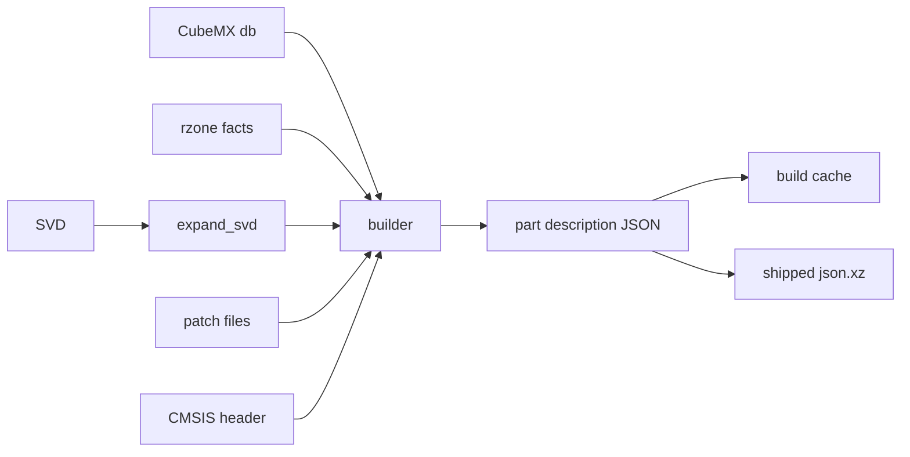

# Descriptions

A part description says what a part is: its core, memory regions, peripherals with registers
and fields, interrupts and GPIO alternate functions. The machine is built from it and never
from ad-hoc arguments.

## The data

The native type is `part_description` in `native/include/popcorn/core/description.hpp`. It
comes with `parse_description`, `load_description`, `dump_description`, `description_digest`
and a JSON Schema from `description_json_schema`. `description_schema_version` is part of the
data. The JSON Schema is committed as `data/schema/part_description.schema.json` and
`python/popcorn/stm32/description/_codegen.py` generates the Python dataclasses of `_model.py`
from it. Do not edit `_model.py` by hand. `popcorn_build/schema.py` builds the `popcorn-describe-schema`
program and rewrites the schema from the native type.

## The pipeline

The modules are in `python/popcorn/stm32/description`:

- `_sources.py` finds the SVD, the CubeMX db, the rzone facts, the GPIO modes file, the CMSIS
  device header and the patch files of a part.
- `_svd.py` expands an SVD: `derivedFrom`, `dim`, clusters and property inheritance. It is a
  pure function of the file bytes.
- `_cubemx.py` reads the part lookup, the memory regions and processor facts, the IP instance
  join and the GPIO alternate functions.
- `_patches.py` applies popcorn's own TOML patches: peripheral drops, fields, cross rules,
  aliases, IP renames, IRQ changes, core overrides, added registers and regions, and the
  device signature. The patches are in the `patches` directory.
- `_builder.py` assembles the description: expand the SVD, read the db and rzone, apply every
  patch, strip the peripheral prefix of register names, build the IRQ table, then assemble the
  core, regions and peripherals.
- `rzone` holds popcorn's own facts for memory regions and core counts, written from the
  reference manual and the datasheet.

The built description is cached as JSON under `$XDG_CACHE_HOME/popcorn/mcu`, keyed by the part,
the core, the schema version, the generator string and the digests of the resolved sources
in `_cache.py`.

## Shipped descriptions

A description can ship in the package as `<RefName>[-<core>].json.xz` under
`python/popcorn/stm32/data`. `_shipped.py` decompresses it on first use, with a hard limit on
the decompressed size. The lookup order of `popcorn.stm32.mcu(part)` is:

1. `<RefName>[-<core>].json`, uncompressed, in a directory of `POPCORN_STM32_DESCRIPTION_DIRS`,
   searched in order.
2. The shipped file, skipped when `svd`, `cubemx_db` or `cmsis_header` is passed or
   `POPCORN_STM32_BUILD` is `local`. Any other value of that variable raises an error.
3. A local build from ST's files, cached.

The [Install](../guide/install.md) page shows the same order from the user side.

`_golden.py` writes a canonical text dump of a description, one line per item. The dump and its
digest file make a change of a shipped description visible in review.

## Digests

`description_digest` is a SHA-256 of the description content. A snapshot stores it and checks it
on load, so a snapshot only loads into a machine built from the same description.
