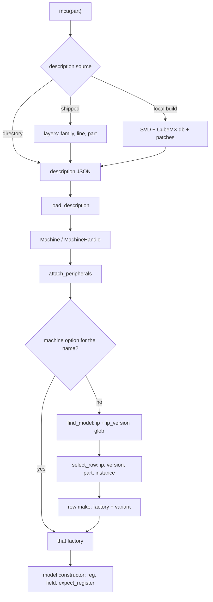

# How a part loads

`popcorn.stm32.mcu("STM32L152RETx")` returns a description. A `Machine` built from it attaches one
model to each peripheral. This page follows that path and states where a difference between
STM32 families belongs.



## The walk

| Stage | Where | What happens |
|---|---|---|
| Source | `description_path` in `python/popcorn/stm32/description/_shipped.py` | A directory of `POPCORN_STM32_DESCRIPTION_DIRS`, then the shipped layers, then a local build through `cached_description` in `_cache.py` |
| Layers | `_layer_paths`, `_compose_packed`, `compose` in `_shipped.py` and `_layers.py` | The family, line and part files of the part overlay into one description. See [Descriptions](descriptions.md) |
| Local build | `build_description_with_report` in `_builder.py` | `expand_svd` reads the SVD, `instance_ips` in `_cubemx.py` gives each peripheral its `ip` and `ip_version`, `resolve_ip` fills the gaps, `apply_patches` in `_patches.py` runs the patch files of `python/popcorn/stm32/description/patches` |
| Load | `load_description` in `python/popcorn/_part_description.py` | The native side parses the JSON into a `part_description` |
| Machine | `Machine` in `python/popcorn/_machine.py`, `options_of` in `native/src/bind/machine.cpp` | Board options and per-name models become `machine_options::models`, a map from instance name to factory |
| Registry | `register_builtin_models` in `native/src/periph/stm32/models.cpp`, `find_model` in `native/src/periph/registry.cpp` | Importing `popcorn._core` loads `libpopcorn_stm32`, whose entry point registers one closure per distinct `(ip, ip_version glob)` pair of the row table |
| Attach | `machine::run_state::attach_peripherals` in `native/src/core/peripherals.cpp` | Per peripheral, in description order: the machine option for the name wins, else `find_model` |
| Row | `select_row` in `models.cpp` | The first row of the table (`builtins()`) whose ip, version glob, families, lines and instance globs all match. The table is the row set of each model, `rcc_rows()`, `pwr_rows()`, `flash_rows()` and so on, one `<model source stem>_rows()` per model source, declared in its IP's `<ip>_rows.hpp` (`exti_u5h5_rows()`, `exti_l1l4_rows()`) |
| Factory | `<ip>_rows.hpp` next to the model | The row's `make` calls a factory, often with a `*_variant` from the same header |
| Model | `stm32_model` in `native/src/periph/stm32/model_base.hpp` | `reg` and `field` bind registers by name, `expect_register` and `expect_field` check the description against the variant |

After all models exist the machine checks claims, served ranges and cross rules. A peripheral
with no model keeps its register file and counts unmodelled accesses. Models then find peers
through the model directory, by instance name or by interface.

### The row table

The row table is a `std::to_array<builtin>` per model, in selection order within the IP, in the model's own `.cpp` and built by `row_of`:

```cpp
{.ip              = "RCC",
 .ip_version_glob = "STM32L1_rcc_*",
 .make            = [](board const& b) { return rcc_l1_factory(b.rcc); },
 .families        = family::l1},
```

`instance_globs` and `lines` are spans of globs, a row matches when any glob matches. Both
default to `every`, which is `{"*"}`. `families` is a set of the `family` enumerators of
`rows.hpp`, `family::u5 | family::h5` for two. `family_of` reads the family of a part from the
prefix of its name once. A row names its families, a row without `families` does not compile.
`shared_families` serves every family and a part with no family, and no row uses it. A part with
no family prefix matches only shared rows. `lines` narrows a row inside its families to some
lines, for the rows of lines that no other line shares the model of. The first matching row
wins, so a specific row sits above its generic row. An empty version glob matches only a
peripheral with an empty version, which is the case for EXTI, PWR, SYSCFG and DBGMCU on some
families.

`register_builtin_models` builds every row's factory once and registers one closure for each
distinct `(ip, ip_version_glob)` pair. The closure calls `select_row` again with the real part
and instance, so one registry entry stands for every row that shares its pair. The registry
itself resolves the newest registration first, and the rows resolve oldest first.

`factories` in `models.cpp` runs `select_row` for every peripheral with a `board`
from `native/include/popcorn/periph/stm32/board.hpp`. The board carries the machine's board options, such
as the RCC clock sources, the VDDA supply or the option bytes. `options_of` uses it to build
factories that shadow the registry for I2C, SPI, RCC, USB, RNG and ADC. `factories` skips
peripherals with `alias_of` set, so an alias such as a secure alias gets no model of its own.

`flash_variant_of` in `flash.cpp` reads the `flash_variant` of the FLASH row back for the FLASH
model. Every other variant goes through the row's `make` into its factory.

## Glossary

- **family**: the first 7 characters of a RefName plus `xx`, such as `STM32U5xx`. It names the
  family layer files. `family_name` in `_layers.py`.
- **line**: the first 9 characters plus `xx`, such as `STM32U575xx`. `line_name` in `_layers.py`.
- **ip**: the IP name the CubeMX db gives an instance, such as `RCC`, `ADC` or `Flash`. The
  spelling differs between families.
- **ip_version**: the IP version string of an instance, such as `STM32U5_rcc_v1_0`. A patch can
  replace it. Rows match it with a glob.
- **category** and **die**: sub-groups of a line, such as STM32L1 Cat.1 to Cat.6 and `DIE416`.
  A die follows the silicon, which a part number glob cannot express. A patch `[match]` tests
  `dies`.
- **family**: an enumerator of `family` in `rows.hpp`, `u5`, `h5`, `l1` or `l4`, derived from the
  part name prefix. A row names the families it serves.
- **line glob**: a pattern over the part number, such as `STM32U535*`. Only the `lines` of a row
  hold one.
- **patch**: a TOML file in `python/popcorn/stm32/description/patches`. It corrects the
  description during a local build and its result ships in the layers.
- **layer**: one of the three shipped file kinds, the family blocks, the line and the part
  deltas. They compose into a description.
- **row**: one `builtin` entry of the row table. It maps an ip, version, part and
  instance to a factory.
- **variant**: a runtime descriptor struct named `*_variant` in the model's `<ip>_rows.hpp`, such
  as `hash_variant` or `flash_variant`. A row passes one to a shared factory to set behaviour
  parameters.
- **traits**: a compile-time parameter of a model template. `rcc_model<Traits>` takes `u5_rcc`,
  `h5_rcc` or `l1_rcc`, `adc_model<Traits>` takes `u5_adc` or `h5_adc`, and
  `flash_model<Traits>` takes `u5_flash` or `h5_flash`.
- **name table**: a `field_table` of `family_names.hpp` that maps the roles of a model to the
  register and field names of a family. An empty name says the family lacks that item.
  `pwr_role` names the PWR fields of each family, `usart_role` the USART fields whose names
  differ between the FIFO sci3, the single-register sci3 of the STM32L4 and the sci2 registers.
- **board option**: a value the user passes to `Machine` for a peripheral, such as `rcc`,
  `supply`, `option_bytes`, `rng` or `usb`. It reaches the model through the `board`.

## Where a family difference goes

| The difference is | Put it in | Example |
|---|---|---|
| a register, field or reset value the SVD gets wrong | a patch | `register_drops` of `ADC.SMPR0` in `stm32l1_cat12.toml` |
| which variant a category gets, die or package based | a patch `[ip] versions` | `"ADC" = "STM32L1_adc_cat12"` in the same file |
| a behaviour parameter of a shared model | a row and its `*_variant` | `hash_h5_sha3` on the `hash_sha3_parts` row |
| a different clock tree or register map shape | a traits template | `u5_rcc`, `h5_rcc` and `l1_rcc` for `rcc_model` |
| a different model | a new row and factory | `adc_l1_factory` for the L1 ADC |

Rules that follow:

- A model never branches on the part number or the family name. The difference lives in the
  description, the variant or the traits.
- Keep a register or field required in every family that has it. A family that lacks it says so
  in its own variant, traits or name table, so a description that lost the item by a bad patch
  still fails at construction.
- A sub-family split of a shipped line goes through a patch version: `STM32U5_smps_pwr` for the
  U5 packages with the SMPS, `STM32U57x_gpio` for the 8-pin port I of the U575 and U585,
  `STM32H5_hash_sha2` for the H5 HASH without SHA-3. A row selects it by version and the family
  scope only.
- The U5 FLASH 5-bit and 8-bit rows of lines not shipped yet split by line glob in `lines` and sit
  above the generic FLASH row of the same version. The H5 SHA-3 HASH row and the H503 HASH row,
  also of unshipped lines, are the two rows of `hash1_v4*`, with disjoint `lines`.
- A new family needs its own enumerator and its rows name it. A shared row adopts any family
  that reuses the ip version.

## Adding a family

1. Add the sources. A local build needs the family's SVD and CubeMX db. `popcorn.stm32.mcu`
   builds and caches the description of a part from them.
2. Write patches in `python/popcorn/stm32/description/patches`. Scope each file with `[match]`
   so it covers exactly the parts that need it. Use `[ip] versions` when a die or category needs
   its own model variant. Check each rule against the SVD of every part of the family.
3. Add golden files and regenerate the shipped layers with
   `uv run python -m popcorn.stm32.description golden <part>` and `... ship <part>`.
4. Add the enumerator to `family` and its prefix to `family_of` in `rows.hpp`, above any
   prefix it extends, give the rows of
   the family its `families` in the row table, so the rows of another family do not adopt it, and
   place each specific row above its generic row. Run
   `uv run python -m popcorn_build.resolution_diff update` and read the diff of the goldens in
   `tests/data/stm32/resolution`: a row that serves a new family shows there, and
   `tests/python/stm32/test_resolution.py` fails for a line glob that reaches two
   families, a row naming a family no part serves, a row no part serves and an instance
   with two matching rows outside the listed overlaps.
5. Add an entry for the family to `debug_maps` and `idau_maps` in `models.cpp`. A family
   without one has no debug blocks and no IDAU map.
6. Write the name tables of the models that bind registers by name, and the traits or variants
   for the differences from the families that exist.
7. Check the result. `python -m popcorn_build.part_sweep --out sweep.json --parts 'STM32XX*'` attaches a Machine
   to each part, and the generated part pages of the support section show which instances got a
   model.

Two families show the steps with a core and a peripheral set of their own:

- The STM32L1 patches in `stm32l1*.toml` split the family into seven categories by die and flash
  size, each file scoped by `[match]` to the parts that need it, and `stm32l1_part_facts.toml`
  holds per-part facts. The L1 rows, `l1_rcc` traits and `adc_l1_factory` serve the Cortex-M3
  parts.
- The STM32L4 patches for the die DIE415 split by line, `stm32l471.toml`, `stm32l475.toml` and
  `stm32l485.toml`, with `stm32l4.toml` for the SVD corrections of all five lines and
  `stm32l4_otg.toml` for the OTG_FS core ID registers the SVDs omit. The model differences
  between the STM32L4 and the families before it are variants and traits, `l4_rng`, `l4_crc`
  and `l4_adc`, and each row names `family::l4`. The example class decoding reads the
  package suffixes of the family from a per-family table, `_FAMILY_PACKAGES`, as the family
  difference rule asks.

## When a row or variant is missing

| Mistake | Result |
|---|---|
| Some row knows the ip and version, none serves the part | `select_row` throws `config_error` at `Machine()`: "no model row of the X version Y serves the part P", at `peripherals.<instance>` |
| No row knows the ip and version | The peripheral keeps plain register storage. Accesses to it are counted as unmodelled and raise `ModelError` under `strict_peripherals` |
| A row matches ip, version and part but not the instance | The peripheral keeps plain register storage |
| A specific row sits below its generic row | The generic row wins with no error |
| The description lacks a register or field the model binds | `reg` or `field` throws `config_error` naming the item |
| The description disagrees with the variant | `expect_register` or `expect_field` throws `config_error` |
| A `debug_maps` or `idau_maps` entry is missing for a family | The part has no debug blocks or IDAU map |

`python -m popcorn.stm32 explain <part> [--trustzone]` prints, per instance, its model, the row
that serves it, the row's factory, variant and board members where the row names them, and why an
instance has none: `row`, `none_no_row` (no row matches) or `none_part_refused` (some row knows
the IP and version, none serves the part). The generated part pages of the support section list,
per IP, version and row, the instances and their model.
