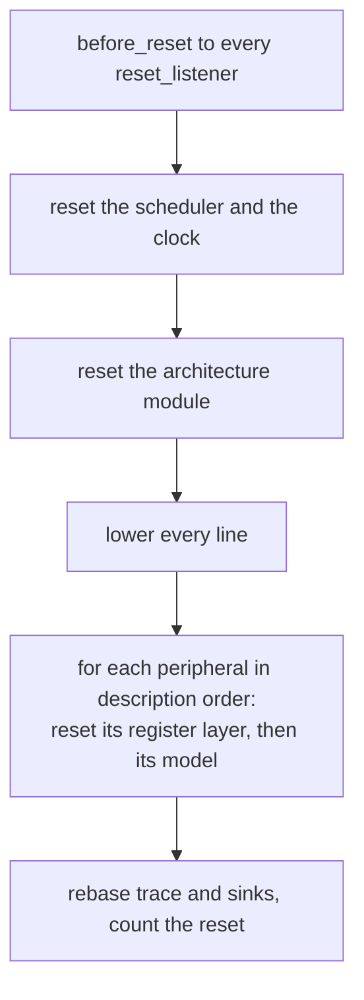

# Peripherals

A peripheral has register storage, optional behavior and lines to the interrupt controller. The
interfaces are in `native/include/popcorn/periph`.

## Register storage and models

`periph::register_file` holds the words of one peripheral instance and serves every register no
model claims. A `periph::model` serves the registers it claims, as the description spells them.
`model::claims()` is called once when the model attaches. For a claimed register the dispatch
never writes the register file. The model pokes whatever it wants visible there, because the
register file is what Python views, the trace and snapshots read.

`model::served_ranges()` names byte ranges the model serves besides its registers, such as the
packet memory of the STM32H5 USB controller. The machine calls it once at attach, after
`claims()`. Each range is a pair of word-aligned offsets from the peripheral base, first included
and last excluded, inside the peripheral's size. Every word of a range is claimed, so every access
in it reaches `on_read` and `on_write`. A range word that holds a description register holds one
of the model's claims. Python models serve their claimed registers only.

A model receives `on_read` and `on_write` with the byte offset, the access size and an
`access_ctx` that says where, when and by whom: the translated block, the instruction count,
the bus master, the security attribute and privilege. A model returns a value or a bus error.
The machine turns a bus error into a guest bus fault for a CPU access and a transfer error for a
DMA access. Other entry points are `reset`, `power_cut`, `on_event` for events the model
scheduled, and `save` and `load` for snapshots.

A model is built from a `model_context`: the register file, the interrupt lines in the order of
`irq_sources()`, the non-maskable interrupt line, the DMA request lines, the model's own event
port, the clock, the machine services, a directory of peer models, the part description and the
strict and TrustZone flags.

## Model index

Which file serves which IP on which family, where its rows are and which tests cover it. `tests/docs/test_model_index.py` keeps the tables complete and the names true, and `tests/python/stm32/test_model_index_rows.py` checks them against the built row tables.

### Models

One row per IP group. The `ip` column lists the strings the row tables use. A family cell holds the model source stem in `native/src/periph/stm32/`, or `-` when no row serves the IP on that family. The suffix of a model source name lists exactly the families whose rows the file registers, in the order u5 h5 l1 l4: `_u5h5`, `_l1l4`, `_l1`. A bare name serves three or more families or is the only model of its IP. `adc4` and `lpgpio` are named for the instance they model. Each model's row table sits in its own source and its rows header declares `<stem>_rows()`.

| IP group | row `ip` strings | u5 | h5 | l1 | l4 | rows header |
|---|---|---|---|---|---|---|
| ADC | `ADC`, `ADC12`, `ADCC`, `ADC_Common` | `adc`, `adc4` | `adc` | `adc_l1` | `adc` | `adc_rows.hpp`, `adc4_rows.hpp` |
| CRC | `CRC` | `crc` | `crc` | `crc` | `crc` | `crc_rows.hpp` |
| CRS | `CRS` | `crs` | `crs` | - | - | `crs_rows.hpp` |
| DAC | `DAC` | `dac` | `dac` | `dac` | `dac` | `dac_rows.hpp` |
| DBGMCU | `DBGMCU`, `DBG` | `dbgmcu` | `dbgmcu` | `dbgmcu` | `dbgmcu` | `dbgmcu_rows.hpp` |
| DMA channels | `DMA` | - | - | `dma_l1l4` | `dma_l1l4` | `dma_rows.hpp` |
| GPDMA, LPDMA | `GPDMA`, `LPDMA` | `gpdma` | `gpdma` | - | - | `dma_rows.hpp` |
| EXTI | `EXTI` | `exti_u5h5` | `exti_u5h5` | `exti_l1l4` | `exti_l1l4` | `exti_rows.hpp` |
| FLASH | `flash`, `Flash` | `flash` | `flash` | `flash_l1` | `flash` | `flash_rows.hpp` |
| GPIO | `GPIO` | `gpio`, `lpgpio` | `gpio` | `gpio` | `gpio` | `gpio_rows.hpp`, `lpgpio_rows.hpp` |
| GTZC | `GTZC` | `gtzc` | `gtzc` | - | - | `gtzc_rows.hpp` |
| HASH | `HASH` | `hash` | `hash` | - | - | `hash_rows.hpp` |
| I2C | `I2C` | `i2c` | `i2c` | `i2c_l1` | `i2c` | `i2c_rows.hpp` |
| ICACHE, DCACHE | `ICACHE`, `DCACHE` | `caches` | `caches` | - | - | `caches_rows.hpp` |
| IWDG | `IWDG` | `iwdg` | `iwdg` | `iwdg` | `iwdg` | `iwdg_rows.hpp` |
| LPTIM | `LPTIM` | `lptim_u5h5` | `lptim_u5h5` | - | `lptim_l4` | `lptim_u5h5_rows.hpp`, `lptim_l4_rows.hpp` |
| MDF, ADF | `MDF` | `mdf` | - | - | - | `mdf_rows.hpp` |
| PWR | `PWR` | `pwr` | `pwr` | `pwr` | `pwr` | `pwr_rows.hpp` |
| RCC | `RCC` | `rcc` | `rcc` | `rcc` | `rcc` | `rcc_rows.hpp` |
| RNG | `RNG` | `rng` | `rng` | - | `rng` | `rng_rows.hpp` |
| RTC, TAMP | `RTC`, `TAMP` | `rtc_u5h5` | `rtc_u5h5` | `rtc_l1l4` | `rtc_l1l4` | `rtc_rows.hpp` |
| SAI | `SAI` | `sai` | `sai` | - | `sai` | `sai_rows.hpp` |
| SBS | `SBS` | - | `sbs` | - | - | `sbs_rows.hpp` |
| SPI | `SPI` | `spi_u5h5` | `spi_u5h5` | `spi_l1l4` | `spi_l1l4` | `spi_rows.hpp` |
| SYSCFG | `SYSCFG`, `SYS` | `syscfg_u5` | - | `syscfg_l1l4` | `syscfg_l1l4` | `syscfg_rows.hpp` |
| TIM | `TIM1_8H5`, `TIM1_8L1`, `TIM1_8L1Cat345`, `TIM1_8L4`, `TIM1_8U5`, `TIM6_7H5`, `TIM6_7L1`, `TIM6_7L1Cat345`, `TIM6_7L4`, `TIM6_7U5` | `tim` | `tim` | `tim` | `tim` | `tim_rows.hpp` |
| USART, UART, LPUART | `USART`, `UART`, `LPUART` | `usart` | `usart` | `usart` | `usart` | `usart_rows.hpp` |
| USB device | `USB`, `USB_SRAM` | - | `usb_drd` | `usb_drd` | - | `usb_rows.hpp` |
| USB OTG_FS | `USB_OTG_FS` | `otg_fs` | - | - | `otg_fs` | `usb_rows.hpp` |
| WWDG | `WWDG` | `wwdg` | `wwdg` | `wwdg` | `wwdg` | `wwdg_rows.hpp` |

### Tests

Test files of `tests/native/stm32/` per IP group and family. `test_<ip>_u5.cpp` runs a U575 part, `_h573` and `_h5` an H573, `_l1` and `_l4` name the family. A program is named `stm32-<ip>[-<family>]`. A `-R` selector for a program ends with `\.` and never with `$`, so `stm32-i2c` does not match `stm32-i2c-l1`.

| IP group | u5 | h5 | l1 | l4 |
|---|---|---|---|---|
| ADC | `test_adc4.cpp`, `test_adc_u5.cpp` | `test_adc_h573.cpp` | `test_adc_l1.cpp` | `test_adc_l4.cpp` |
| CRC | `test_crc_u5.cpp` | - | `test_crc_l1.cpp` | `test_crc_l4.cpp` |
| CRS | `test_crs_u5.cpp` | - | - | - |
| DAC | `test_dac_u5.cpp` | `test_dac_h5.cpp` | `test_dac_l1.cpp` | `test_dac_l4.cpp` |
| DBGMCU | `test_dbgmcu_u5.cpp` | - | - | - |
| DMA channels | - | - | `test_dma_l1.cpp` | `test_dma_l4.cpp` |
| GPDMA, LPDMA | `test_gpdma_u5.cpp`, `test_lpdma.cpp` | `test_gpdma_h573.cpp` | - | - |
| EXTI | - | - | `test_exti_l1.cpp` | `test_exti_l4.cpp` |
| FLASH | `test_flash_u5.cpp` | `test_flash_h573.cpp` | `test_flash_l1.cpp` | `test_flash_l4.cpp` |
| GPIO | `test_gpio_u5.cpp`, `test_lpgpio.cpp` | - | `test_gpio_l1.cpp` | `test_gpio_l4.cpp` |
| GTZC | `test_gtzc_u5.cpp` | - | - | - |
| HASH | `test_hash_u5.cpp` | `test_hash_h573.cpp` | - | - |
| I2C | `test_i2c_u5.cpp` | - | `test_i2c_l1.cpp` | `test_i2c_l4.cpp` |
| ICACHE, DCACHE | `test_caches_u5.cpp` | - | - | - |
| IWDG | `test_iwdg_u5.cpp` | - | `test_iwdg_l1.cpp` | `test_iwdg_l4.cpp` |
| LPTIM | `test_lptim_u5.cpp` | `test_lptim_h5.cpp` | - | `test_lptim_l4.cpp` |
| MDF, ADF | `test_adf.cpp`, `test_mdf_u5.cpp` | - | - | - |
| PWR | `test_power_u5.cpp` | `test_power_h573.cpp` | `test_power_l1.cpp` | `test_power_l4.cpp` |
| RCC | `test_rcc_u5.cpp` | `test_rcc_h573.cpp` | `test_rcc_l1.cpp` | `test_rcc_l4.cpp` |
| RNG | `test_rng_u5.cpp` | - | - | `test_rng_l4.cpp` |
| RTC, TAMP | `test_rtc_u5.cpp` | - | `test_rtc_l1.cpp` | `test_rtc_l4.cpp` |
| SAI | `test_sai_u5.cpp` | - | - | `test_sai_l4.cpp` |
| SBS | - | - | - | - |
| SPI | `test_spi_u5.cpp` | - | `test_spi_l1.cpp` | `test_spi_l4.cpp`, `test_spi_l4_class.cpp` |
| SYSCFG | - | - | - | - |
| TIM | `test_tim_u5.cpp` | - | `test_tim_l1.cpp` | `test_tim_l4.cpp` |
| USART, UART, LPUART | `test_usart_u5.cpp` | - | `test_usart_l1.cpp` | `test_usart_l4.cpp` |
| USB device | - | `test_usb_drd.cpp`, `test_usb_drd_device.cpp` | `test_usb_l1.cpp` | - |
| USB OTG_FS | `test_otg_fs_device.cpp`, `test_otg_fs_host.cpp`, `test_otg_fs_u5.cpp` | - | - | `test_otg_fs_l4.cpp` |
| WWDG | `test_wwdg_u5.cpp` | `test_wwdg_h5.cpp` | `test_wwdg_l1.cpp` | `test_wwdg_l4.cpp` |

Test files that cover no single IP: `test_at25sf.cpp`, `test_attach_h573.cpp`, `test_attach_u575.cpp`, `test_base.cpp`, `test_class_a_h573.cpp`, `test_dfilter_chain.cpp`, `test_dma_routing.cpp`, `test_engine_counters.cpp`, `test_family_rows.cpp`, `test_flash_geometry.cpp`, `test_flash_secure.cpp`, `test_gpio_analog.cpp`, `test_h5_names.cpp`, `test_i2c_devices.cpp`, `test_i2c_medium.cpp`, `test_link_queues.cpp`, `test_pty.cpp`, `test_rcc_gate.cpp`, `test_smc.cpp`, `test_smoke_l1.cpp`, `test_smoke_l4.cpp`, `test_spi_medium.cpp`, `test_system_uart.cpp`, `test_tim_spi_h573.cpp`, `test_tz_aware.cpp`, `test_uart_wire.cpp`, `test_unregistered.cpp`.

Benchmarks and test helpers: `bench_irq.cpp`, `bench_system.cpp`, `bench_common.hpp`, `boot_alias_checks.hpp`, `dac_ur_cases.hpp`, `h573_secure_rig.hpp`, `reserved_slave_word.hpp`, `stm32_fixture.hpp`, `trigger_probe.hpp`, `usb_drd_rig.hpp`, `wwdg_cases.hpp`, `wwdg_hardware_cases.hpp`, `wwdg_ll_cases.hpp`, `wwdg_sleep_cases.hpp`.

### Other sources

Sources in `native/src/periph/stm32/` that are not models: `models.cpp`, `plugin.cpp`, `uart_wire.cpp`, `i2c_medium.cpp`, `spi_medium.cpp`.

`models.cpp` builds the row table and selects the row, `plugin.cpp` is the entry point of the library, and the three wires connect machines.

Headers that are not rows headers: `adc_pads.hpp`, `analog_peers.hpp`, `backup_domain.hpp`, `bus_window.hpp`, `debug_freeze.hpp`, `dfilter_chain.hpp`, `dma.hpp`, `dma_data.hpp`, `dma_signal.hpp`, `exti_l1l4.hpp`, `factory_data.hpp`, `family_names.hpp`, `flash_option.hpp`, `flash_unit.hpp`, `frame_signal.hpp`, `gpdma_requests.hpp`, `gpio_peers.hpp`, `gtzc.hpp`, `hash_wide.hpp`, `hook_failure.hpp`, `hsi16_source.hpp`, `i2c_link_port.hpp`, `i2c_medium.hpp`, `i2c_port_queue.hpp`, `kernel_gate.hpp`, `link_medium.hpp`, `lsi_source.hpp`, `medium_tap_queue.hpp`, `memory_alias.hpp`, `model_base.hpp`, `pin_range.hpp`, `pwr_peers.hpp`, `rcc_enables.hpp`, `rcc_graph.hpp`, `rcc_h5.hpp`, `rcc_l1.hpp`, `rcc_l4.hpp`, `rcc_resets.hpp`, `rcc_u5.hpp`, `read_protection.hpp`, `row_of.hpp`, `rows.hpp`, `rtc_calendar.hpp`, `rtc_core.hpp`, `secure_config.hpp`, `sigma_delta.hpp`, `spi_bus.hpp`, `spi_link_port.hpp`, `spi_medium.hpp`, `target_port.hpp`, `temporal_isolation.hpp`, `trigger_signal.hpp`, `usb_device_link.hpp`, `voltage_range.hpp`.

## Choosing the model

`native/src/core/peripherals.cpp` builds the models in description order. For each peripheral
it takes the factory from the machine options by instance name first. If there is none it asks
the registry, `periph::find_model`, which matches the peripheral's IP name and a glob of its IP
version. The newest registration that matches wins. A plugin cannot call `register_model`
itself, the registry refuses it, and a plugin registers through its entry point instead. [How a part loads](part_loading.md)
follows the built-in STM32 rows from the description to the model.

After the factory returns, the machine checks that every claimed register exists in the
description, that every served range is word aligned with its first offset at most its last, fits
the peripheral's size and covers only claimed registers, and that cross rules point into claimed
registers consistently. It refuses the model with a `config_error` otherwise: under
`models.<name>.served_ranges` for a misaligned or inverted range, `peripherals.<name>.size` for a
range past the size and `peripherals.<name>.registers.<reg>` for an unclaimed register in a range.

## Python models

`native/src/bind/model_trampoline.cpp` implements `periph::model` for a Python class
`popcorn.model.Model`. It calls the private methods `_claims`, `_reset`, `_read`, `_write`,
`_event`, `_save` and `_load`, each under the GIL. `None` from `_read` and `False` from `_write`
become a bus error. Once the machine's Python side is collected, no method is called and the
run is asked to stop.

## Documenting a model's limits

The limits of a model live in its class doc, and the docs build generates one page per IP from
them, see [Limits](../support/limits/index.md). A limits block is a doxygen block in a file under
`native/src/periph/stm32` that follows the model's `@brief` with an `@limits` line and one or more
`@group` sections of markdown:

```cpp
/**
 * @brief CRC calculation unit ...
 *
 * @limits crc CRC
 *
 * @group all unmodelled
 * - The RCC clock gate is not modelled.
 *
 * @group u5,h5,l4 deviation "Differs from RM0456 and RM0351"
 * - An even polynomial is computed anyway and logged.
 */
```

- `@limits <id> <Title>` names the page. One id may appear in several files: the file that
  carries the title leads, the others carry `@limits <id>` alone. Groups appear in file name
  order, then in file order.
- `@group <scopes> <kind> ["heading"]` opens a section. The scopes are `all` or a comma list of
  `u5`, `h5`, `l1` and `l4`. The kinds are `unmodelled`, `deviation`, `rule` and `note`. A heading
  that is not quoted is built from the scopes and the kind. A heading must be unique on the page,
  and a quoted one may wrap over two lines.
- The body is markdown, one bullet per fact. Mark a rule no manual states with the word
  `inferred`, the page counts the marks.
- A block holds one `@limits`, and no other tag may stand between it and its groups. A malformed
  block fails the docs build with its file and line.
- A public header carries no limits block, doxygen reads those.

## Lines

`irq_line` and `dma_request` are level-driven. A line connected to nothing only keeps its
level. A reset lowers every line of every peripheral.

## Resets and snapshots

The reset sequence is `machine::run_state::reset_machine` in `native/src/core/run_loop.cpp`:



- The register layer holds the words no model claims. In a register that declares fields, the
  bits no field covers are constant: they read their reset value and ignore writes. A model
  keeps such a word, its bits and its write-once lock, over a reset kind by answering
  `keeps_over_reset`.
- Layer reset and model reset run per peripheral in one loop, so a model that reads a peer
  during its reset sees a peer that is not reset yet when the peer comes later in the order.
- A model that must finish work due before a reset implements `periph::reset_listener`. The
  machine finds it with `dynamic_cast` and calls it in description order, for every reset kind.
- A model that computes state lazily implements `periph::snapshot_listener`, called at the
  start of every snapshot before anything is captured.
- A power cycle calls `power_cut` on every model before the power-on reset, while the model's
  state and the clock are still those of the cut. A model with non-volatile content uses it to
  apply what the cut leaves of an operation in flight. A plain reset never calls it.
- The clock keeps the time run before the reset: a power-on reset starts from zero, other kinds
  keep the sum.
