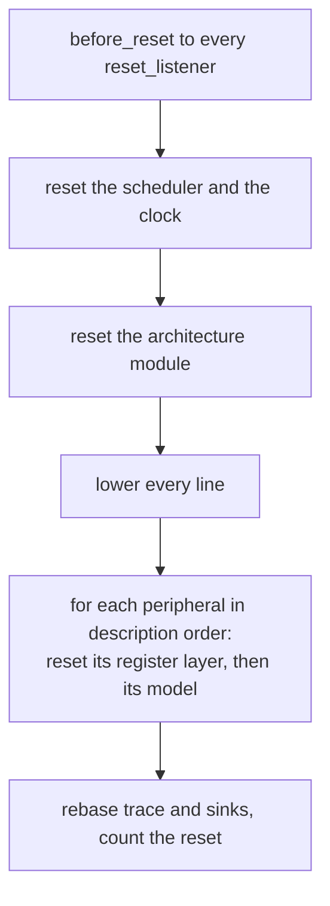

# Peripherals

A peripheral has register storage, optional behavior and lines to the interrupt controller. The
interfaces are in `native/include/popcorn/periph`.

## Register storage and models

`periph::register_file` holds the words of one peripheral instance and serves every register no
model claims. A `periph::model` serves the registers it claims, as the description spells them.
`model::claims()` is called once when the model attaches. For a claimed register the dispatch
never writes the register file. The model pokes whatever it wants visible there, because the
register file is what Python views, the trace and snapshots read.

`model::served_ranges()` names byte ranges the model serves besides its registers, such as the
packet memory of the STM32H5 USB controller. The machine calls it once at attach, after
`claims()`. Each range is a pair of word-aligned offsets from the peripheral base, first included
and last excluded, inside the peripheral's size. Every word of a range is claimed, so every access
in it reaches `on_read` and `on_write`. A range word that holds a description register holds one
of the model's claims. Python models serve their claimed registers only.

A model receives `on_read` and `on_write` with the byte offset, the access size and an
`access_ctx` that says where, when and by whom: the translated block, the instruction count,
the bus master, the security attribute and privilege. A model returns a value or a bus error.
The machine turns a bus error into a guest bus fault for a CPU access and a transfer error for a
DMA access. Other entry points are `reset`, `power_cut`, `on_event` for events the model
scheduled, and `save` and `load` for snapshots.

A model is built from a `model_context`: the register file, the interrupt lines in the order of
`irq_sources()`, the non-maskable interrupt line, the DMA request lines, the model's own event
port, the clock, the machine services, a directory of peer models, the part description and the
strict and TrustZone flags.

## Choosing the model

`native/src/core/peripherals.cpp` builds the models in description order. For each peripheral
it takes the factory from the machine options by instance name first. If there is none it asks
the registry, `periph::find_model`, which matches the peripheral's IP name and a glob of its IP
version. The newest registration that matches wins. A plugin cannot call `register_model`
itself, the registry refuses it, and a plugin registers through its entry point instead.

After the factory returns, the machine checks that every claimed register exists in the
description, that every served range is word aligned with its first offset at most its last, fits
the peripheral's size and covers only claimed registers, and that cross rules point into claimed
registers consistently. It refuses the model with a `config_error` otherwise: under
`models.<name>.served_ranges` for a misaligned or inverted range, `peripherals.<name>.size` for a
range past the size and `peripherals.<name>.registers.<reg>` for an unclaimed register in a range.

## Python models

`native/src/bind/model_trampoline.cpp` implements `periph::model` for a Python class
`popcorn.model.Model`. It calls the private methods `_claims`, `_reset`, `_read`, `_write`,
`_event`, `_save` and `_load`, each under the GIL. `None` from `_read` and `False` from `_write`
become a bus error. Once the machine's Python side is collected, no method is called and the
run is asked to stop.

## Lines

`irq_line` and `dma_request` are level-driven. A line connected to nothing only keeps its
level. A reset lowers every line of every peripheral.

## Resets and snapshots

The reset sequence is `machine::run_state::reset_machine` in `native/src/core/run_loop.cpp`:

- Layer reset and model reset run per peripheral in one loop, so a model that reads a peer
  during its reset sees a peer that is not reset yet when the peer comes later in the order.
- A model that must finish work due before a reset implements `periph::reset_listener`. The
  machine finds it with `dynamic_cast` and calls it in description order, for every reset kind.
- A model that computes state lazily implements `periph::snapshot_listener`, called at the
  start of every snapshot before anything is captured.
- A power cycle calls `power_cut` on every model before the power-on reset, while the model's
  state and the clock are still those of the cut. A model with non-volatile content uses it to
  apply what the cut leaves of an operation in flight. A plain reset never calls it.
- The clock keeps the time run before the reset: a power-on reset starts from zero, other kinds
  keep the sum.
