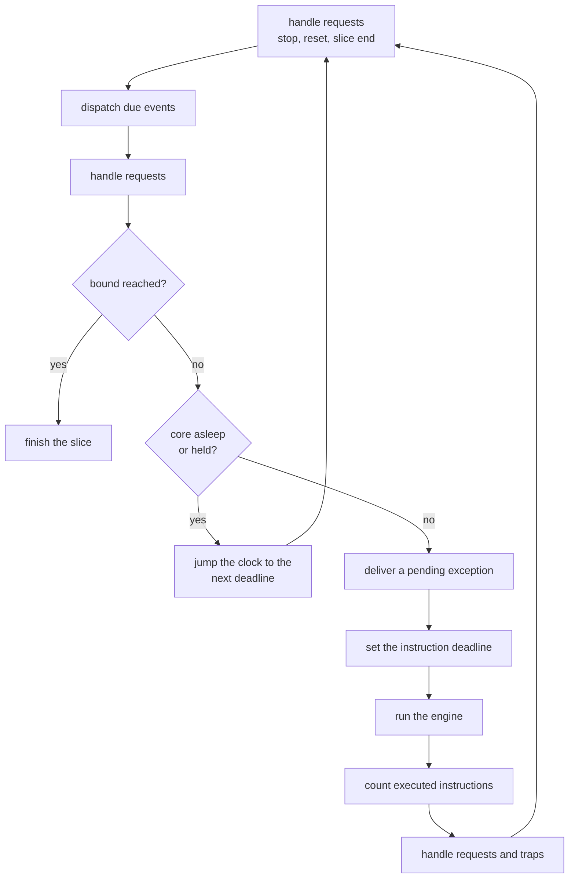

# Run loop

A machine runs in slices. A slice executes translated blocks until a bound ends it, then
returns to its caller, which yields to Python and calls again. The loop is
`machine::run_state::run` in `native/src/core/run_loop.cpp`.

## Time

The virtual clock counts executed instructions. Virtual time is piecewise linear: each change
of the core rate starts an epoch, and time inside an epoch is the instructions since its start
divided by the instruction rate, `core_hz / cpi`. The clock never reads wall time. The
instruction counter advances once per translated block, so it is exact to the block.

A core asleep in WFI executes nothing. When nothing is deliverable the loop jumps the clock to
the next deadline, which is why a sleeping firmware runs fast. The slice keeps two counters,
`executed` and `jumped`. A run's `budget` counts `executed` only, and `max_instructions`
counts both.

## Events

Models schedule events on the scheduler. It orders them by due count, then lane, then sequence
number. A deadline counts either executed instructions or virtual time. The loop dispatches
every event due at the current count before it runs the engine, and it never runs the engine
past the earliest pending deadline.

## One turn of the loop

In order, one turn of the loop:

1. Handles requests. A model or handler may have asked for a stop, a reset or the end of the
   slice. A requested reset becomes a RESET_REQUEST stop when a call is running or the machine
   is configured to stop on it. Otherwise the machine resets and the run goes on.
2. Dispatches the events due at the current instruction count.
3. Checks the bounds, in this order: the call return sentinel, `budget_left`,
   `exact_instructions`, `until_time`, the `until` addresses, `until_return`, and last
   `max_instructions`, which ends the slice without a stop.
4. When the core sleeps or is held, jumps the clock to the earliest of the next event, the time
   bound and the instruction bound. With no event and no time bound it stops with IDLE.
5. Otherwise delivers a pending exception, takes the smallest of the instruction bounds and the
   next event as the deadline, and starts the engine with `uc_emu_start`.
6. After the engine returns, adds the executed instructions, handles requests, then turns a bus
   fault or an unmapped access into a stop or a resume through the architecture module.

The engine stops at the deadline, at an address of the exit list, or when a hook asks it to.
The exit list holds the `until` addresses and the call return sentinel. A slice that starts at
one of them executes one instruction first when `leave_until` is set, so a repeated run goes on
to the next hit.

## Bounds of a slice

`slice_request` in `native/include/popcorn/core/machine.hpp` carries the bounds. Only `until`,
`budget_left`, `exact_instructions`, `until_time` and `stop_when` stop the run. The others, the
instruction cap of one million and the wall budget of one millisecond read every 256 blocks,
only end the slice so the caller can yield. `exact_instructions` runs whole blocks up to the
last block boundary before the count, then single-steps the rest. `stop_when` is evaluated
after each dispatched event and at the slice end, never per instruction.

## Finishing

`finish` turns the end into a `stop` record: the reason, the program counter, the instruction
count, the virtual time, the reset count and any fault. A requested stop wins over a
`stop_when` stop at the same boundary. For a stop the caller sees, `finish` locates the program
counter in the images and writes a stop record to the trace.

Stop reasons are the `stop_reason` enum in `native/include/popcorn/core/types.hpp`. The Python
`StopReason` mirrors it.
