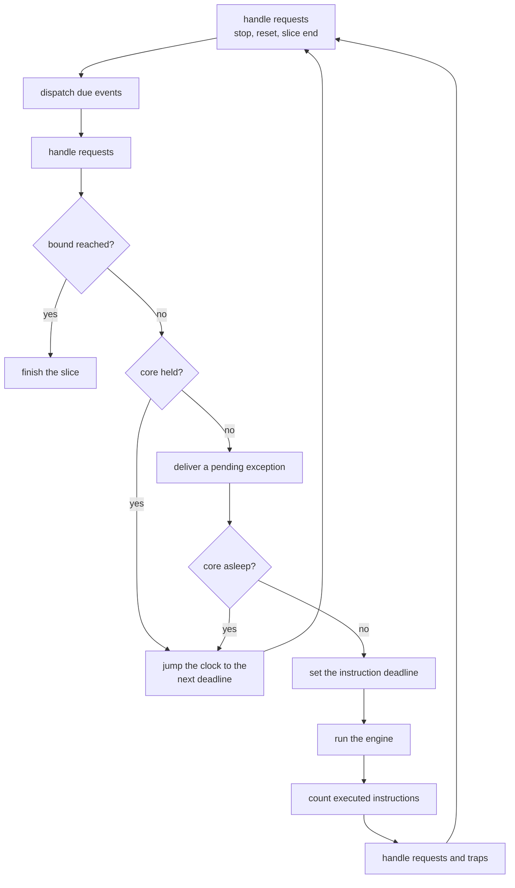

# Run loop

A machine runs in slices. A slice executes translated blocks until a bound ends it, then
returns to its caller, which yields to Python and calls again. The loop is
`machine::run_state::run` in `native/src/core/run_loop.cpp`.

## Time

The virtual clock counts executed instructions. Virtual time is piecewise linear: each change
of the core rate starts an epoch, and time inside an epoch is the instructions since its start
divided by the instruction rate, `core_hz / cpi`. The clock never reads wall time. The
instruction counter advances once per translated block, so it is exact to the block.

The engine counts blocks in one of two modes, chosen at each engine run:

- Budget mode, the default. Translated code tests a budget at each block start and subtracts
  the block's instruction count from it, and the block hook does not run. The budget is armed
  to the deadline or the next event, whichever comes first, capped at 65536 instructions, and 0
  while a stop is pending or an exception is deliverable. Every engine callback runs inside an
  `engine_entry`, or `machine_services::engine_callback` for the arch module's own: the
  outermost one charges the clock with the instructions counted since the last arm on entry,
  and re-arms the budget on exit, since a callback may schedule an earlier event, change the
  rate or raise an exception. An MMIO record or access context outside the exact pc hook
  carries the start of the block making the access.
- Live mode. The block hook runs at every block, charges it and tests the stop conditions. A run
  is live while a per-block observer is on: stepping, coverage, block trace records, spin
  detection or a return watch. A budget run turns live at the callback that leaves an exception
  pending and masked, since an instruction can unmask it with no callback.

Both modes charge each block at its start and stop before the same block, so every output is
the same.

An intercept or a probe stands at a code site inside its block. The block start has charged the
whole block when the site runs, so the site takes the instructions from itself to the block end
back before it reads the clock, `clock_driver::rewind`, and charges them again when the run
goes on through the block. A callback reads the time of its site and a stop or a return at the
site counts the instructions before it, as an `until` stop at the same address does. A fault or
an exception inside a block counts the block in full. A site inside a Thumb IT block, found by
decoding the block from its first instruction, keeps the full charge: the engine ends no run
inside an IT block, so a stop there lands after the block, and `returns` there raises
`EmulationError`.

An access error recorded inside an IT block ends the run by one of two paths, and the block is
counted in full either way. A faulting load leaves at the load: the engine cannot give the
instruction a value, so `load_helper` exits and restores the state to the load. A faulting store
records the error and returns, the block runs on, and the exit-after-instruction helper the
translator emits after the block's last instruction leaves with the state at that instruction.

A core asleep in WFI executes nothing. When nothing is deliverable the loop jumps the clock to
the next deadline, which is why a sleeping firmware runs fast. The slice keeps two counters,
`executed` and `jumped`. A run's `budget` counts `executed` only, and `max_instructions`
counts both.

A core in a branch to itself, a one-instruction block that `arch::self_branch` names, such as
Arm `b .` outside an IT block, executes instructions. In live mode, when the last block hook saw
the same one-instruction block, the arch decodes it from its bytes and the core state. When
nothing is deliverable the hook then advances the clock to the deadline or the next event,
whichever comes first, then stops the engine before the block. In budget mode the engine
consumes the rest of the budget in the block itself when no code hook is on it, which counts the
same instructions. The skipped iterations
count as executed, as if they had run, so every output equals the slow path. The skip is off
while a per-block observer is on: stepping, coverage, block trace records, spin detection, a
return watch, or a code hook site on the block. `self_branch_skips` in the run counters counts
the skips.

## Events

Models schedule events on the scheduler. It orders them by due count, then by exact due time,
then lane, then sequence number. Events due inside one instruction fire in time order, whatever
their lane, so a host or link event due earlier in the instruction fires before a local one due
later. An instruction-counted event and a time event due on the instruction boundary share the
boundary's time and keep lane and posting order. The machine's loop event stays behind every
other event of its count. A deadline counts either executed instructions or virtual time. The
loop dispatches every event due at the current count before it runs the engine, and it never
runs the engine past the earliest pending deadline.

## One turn of the loop

In order, one turn of the loop:

1. Handles requests. A model or handler may have asked for a stop, a reset or the end of the
   slice. A requested reset becomes a RESET_REQUEST stop when a call is running or the machine
   is configured to stop on it, which `Machine(on_reset_request="stop")` selects and is the default.
   A run that waits for thread mode stops the same way. Otherwise, under
   `on_reset_request="reset"`, the machine resets and the run goes on.
   A RESET_REQUEST stop keeps its kind as `reset_pending` until a reset or a restore, saved in
   snapshots. The Python binding applies it with `machine::apply_reset_request` before the next
   run, step or free run of a lone machine starts, so `for_` counts from the reset. A call never
   applies it. A system handles its members' requests itself.
2. Dispatches the events due at the current instruction count.
3. Checks the bounds, in this order: the call return sentinel, `budget_left`,
   `exact_instructions`, `until_time`, the `until` addresses, `until_return`, and last
   `max_instructions`, which ends the slice without a stop.
4. When the core is held, as a halted member of a system is, or the slice runs with `execute`
   off, jumps the clock to the earliest of the next event, the time bound and the instruction
   bound. With no event and no time bound it stops with IDLE.
5. Otherwise delivers a pending exception. A pending interrupt therefore wakes a core in WFI
   before any jump. If the core still sleeps after the delivery, it jumps the clock as in step 4.
6. Otherwise takes the smallest of the instruction bounds and the next event as the deadline,
   picks budget or live mode and starts the engine with `uc_emu_start`. A budget run that
   reaches its cap with nothing due and the wall budget left starts the engine again at once.
7. After the engine returns, adds the executed instructions, handles requests, then turns a bus
   fault or an unmapped access into a stop or a resume through the architecture module.

The engine stops at the deadline, at an address of the exit list, or when a hook asks it to.
The exit list holds the `until` addresses and the call return sentinel. A slice that starts at
one of them executes one instruction first when `leave_until` is set, so a repeated run goes on
to the next hit.

## Bounds of a slice

`slice_request` in `native/include/popcorn/core/machine.hpp` carries the bounds. The bounds
`until`, `budget_left`, `exact_instructions`, `until_time` and `stop_when` stop the run. The
instruction cap of one million and the wall budget of one millisecond, read every 256 blocks in
live mode and at each budget cap in budget mode, about every 65536 instructions, only end the
slice so the caller can yield. `exact_instructions` runs whole blocks up to the
last block boundary before the count, then single-steps the rest. `stop_when` is evaluated
after each dispatched event, at a slice end set by `max_instructions` and, for a request with
`stop_when_events_only`, once when the core falls asleep, never per
instruction and never at a slice end set by the wall budget, a host stop request or a mail
post (`slice_end::wall_dependent`), so the stop point depends on the emulated input alone.
The run state carries the executed and jumped instructions of earlier wall-dependent slice
ends of a slice with a `stop_when` into the next slice's `max_instructions` count, so the
instruction-count end falls at the same instruction whatever the wall budget.

## Host stamps

A host stamp, `host::post` with a time, runs on the host thread between slices, after every
event due at or before the exact instruction count of its boundary. `apply_due` in
`native/src/core/host.cpp` runs due stamps only when no event is pending at that count. A slice
can end at the boundary before `dispatch_due` drained it: mail at the turn top after an idle
jump, the wall check every 256 events, or a `stop_when` stop between two events of the instant.
The stamp then stays pending. The next slice, bounded at the stamp by its `until_time`, drains the
rest of the instant and stops on TIME before any instruction, and the stamp runs at that end. A
stamp due at a reported stop with events still pending runs in the next run.

A slice's own `until_time` follows the same rule. `finish` makes the TIME stop of a request
without `hold_from_until` only once no event is pending at the exact count. A slice that ends
there earlier, by mail or the wall budget, ends without a stop and writes no trace stop record.
The goal goes on into the release slice, which drains the instant and stops on TIME. The parked
state and the trace after a goal's TIME stop are the same whatever wall time or mail did. A
system's hold slices stop on TIME with their events held on purpose.

Both rules read the exact count, `clock_driver::exact_now`, the count `dispatch_due` drains to.
After a `clock_driver::retract` the clock holds a higher count until execution passes it, and a
model event scheduled at `clock::now()` keys to that held count, past the exact one. The host
picks due stamps by the exact time and resolves them with it, so a stamp it holds for a time
between the exact and the held count waits for execution to reach it. Posts compare with the
machine's time, `clock::time()`, the time Python reads: a post before it is in the past, and a
parked post at it runs at once.

## Finishing

`finish` turns the end into a `stop` record: the reason, the program counter, the instruction
count, the virtual time, the reset count and any fault. A requested stop wins over a
`stop_when` stop at the same boundary. For a stop the caller sees, `finish` locates the program
counter in the images and writes a stop record to the trace.

Stop reasons are the `stop_reason` enum in `native/include/popcorn/core/types.hpp`. The Python
`StopReason` mirrors it.
