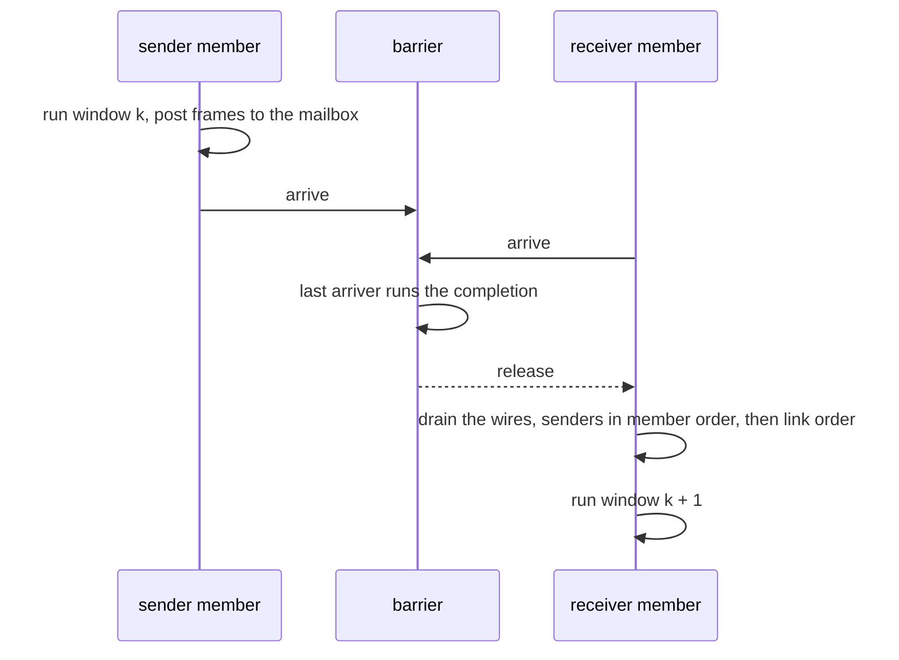

# Systems

A `core::system` runs several machines on one virtual clock and links their UARTs. The type is
declared in `native/include/popcorn/core/system.hpp`. The Python `System` wraps it.

## Members and hosts

Each member is a machine served by its own host, which owns a native thread, see
[Threads](threads.md). The system links the hosts of its members with `member_link` wires. A
wire is one direction of a link. It has a sender, a receiver and a latency `L` above zero.

## Windows and the barrier

The members meet at a `window_barrier` every quantum `Q` of system time. `Q` is the smallest
latency of the system, and the barriers fall at the system times `k * Q` from the start.

- A member whose core runs is held at each barrier with `slice_request::hold_from_until`, so
  every post reaches its receiver at its exact time whatever `Q`, the slicing or the thread
  timing.
- A sender appends a frame to the mailbox of its current window. After barrier `k` the
  receiver drains the mailbox of window `k` on its own thread. The sender writes that mailbox
  again only in window `k + 2`, which holds only while every member arrives at every barrier.
- A frame that ends at sender time `t` is delivered at `t + L`.
- `member_link::sender_reset` and `receiver_reset` tell a link that a member reset. A frame in
  flight at a sender reset is aborted, and a receiver reset drops the frames whose arrival is
  still on the line, so the dropped set depends on the reset time and `L` only.

The barrier is `window_barrier` in `native/src/core/window_barrier.cpp`. The last party to
arrive runs a completion, then bumps a generation counter and wakes the sleepers. Waiters sleep
on a futex until that wake.

## Cost of a window

Every window costs the same work whatever the links carry: each member ends its engine run at
the barrier, the early arrivers sleep on the futex and the last one wakes them, each member
drains its inbound wires, plans its next slice and starts its engine again. Measured with
`perf` on two members at 460800 baud, 16-CPU x86 host, the difference between `L` = 5 us and
`L` = 100 us over 1.9 M windows:

- 2.6 us of wall time and 3.7 us of CPU per window, one voluntary context switch per window per
  sleeping member.
- 1.25 us of user CPU: engine exit and entry with block lookup 380 ns, translated code of blocks
  cut at the barrier 177 ns, memory dispatch 155 ns, barrier, planning and drains 111 ns, host
  mutex 106 ns, run loop 98 ns, host turn 61 ns, trace 32 ns.
- The rest in the kernel: one FUTEX_WAIT and one FUTEX_WAKE per window and the wake-up.
- No Python per window.

The window count is 1 / `Q` per virtual second, so the cost grows as `Q` shrinks, see the table
in the guide's "Latency and wall time".

## Halted members

A member with no goal while another member runs one is halted. Its core is held and it advances
to the system's decision after each barrier, so its clocks, peripherals and DMA follow system
time. A halted member's time counts in its instruction count but not in a goal's budget.

## Members asleep at a member stop

A member whose goal runs and whose core sleeps stops a slice where it fell asleep, so its
position at a pause depends on `Q`. When a pause delivers a member stop at `P`, every such member
below `P` runs on to `P` after the third completion fixed the outcome as that member stop, past
the pause's drain. Its slice holds at `P` with `hold_from_until`, `stop_quiescent` off. It
executes nothing on the way: it slept with no event due before the barrier, and the pause's
drain hands only frames that arrive at or after the barrier. A member asleep past `P` stays
where it fell asleep. Parking applies to delivered member stops only.

## Locks

The system has one mutex. Only threads that are not host threads take it, and a thread holding
it takes at most one host mutex at a time. Host threads never take the system mutex.

## Determinism

The frames, their times and every member's state do not depend on `Q`, on the slicing or on
the thread timing. The barrier and the mailbox rules above give that property, and the
linked_uart example tests it at several quanta, slicings and CPU counts.
