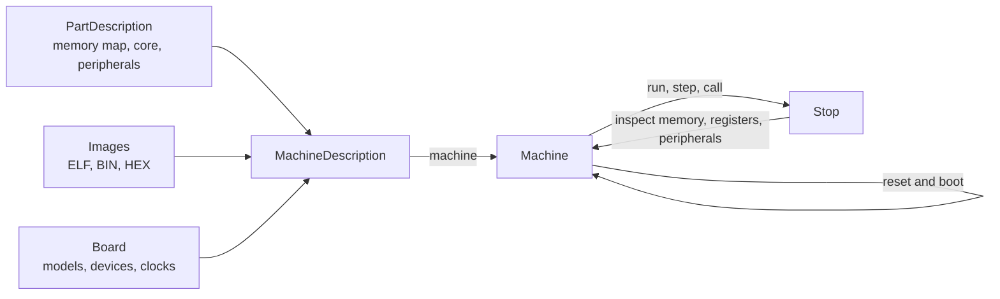

# Concepts

A test describes a machine, builds it, runs it until something stops it, then checks what the
firmware did.

## MachineDescription

`popcorn.MachineDescription` is everything a machine is built from, as plain data:

- `part`, the part number, such as `STM32U575QGIx`. It selects the part description.
- `images`, the firmware files loaded in order: `popcorn.Elf`, `popcorn.Bin` or `popcorn.Hex`.
- `boot`, how the machine boots: `popcorn.Boot(until="main", budget=...)` resets and runs to a
  symbol.
- `board`, what the board does with each peripheral: a model of your own, bus devices on an I2C
  or SPI bus, a UART bridge.
- Clocks and options: `rcc`, `supply`, `option_bytes`, `rng`, `core_hz`.
- Policies: `faults` and `strict`. See [Faults and errors](faults.md).
- Also: `name`, `core`, `cpi`, `missing`, `plugins` for native plugins and `configs` for named
  variants of one description that pytest fixtures select.

It compares and hashes by content. Its `digest` names it across processes, and the pytest
plugin uses it to cache boots.

## PartDescription

The part description holds the memory map, the core, the peripherals with their registers and
fields, and the interrupts. `popcorn.stm32.mcu(part)` loads it, as [Install](install.md)
explains. `MachineDescription.part_description()` returns the one a machine description uses.

## Machine

`popcorn.Machine` is one emulated MCU: the core, its memory, and a model per modelled
peripheral. `MachineDescription.machine()` builds one, powered off. `boot_machine()` resets it
and runs the boot.

The machine runs on its own thread. `run`, `step` and `call` are coroutines: the test awaits
them while the machine runs. A parked machine, one that is not running, exposes its state
directly:

- `m.mem`, memory by address.
- `m.reg`, the core registers.
- `m.periph`, the peripherals with their registers, fields and pins.
- `m.var(name)`, a firmware variable, typed from the ELF's DWARF.
- `m.time` and `m.pc`.

## Peripherals and models

Each peripheral instance of the part has register storage. A model gives it behaviour: flags,
interrupts, DMA requests and timing. popcorn ships built-in models for most STM32U5 peripherals,
listed on the [part pages](../support/generated/parts.md). A test can add a model written in
Python, or load one from a native plugin.

A peripheral with no model keeps plain storage. A firmware access to it logs a warning, and
raises `ModelError` when the machine is strict.

## Virtual time

The machine counts time in core clock cycles, not wall time. `m.time` is the virtual time since
the last reset. A run with `for_=ms(1)` stops after 1 ms of virtual time, however long it takes
on the host. A core asleep in WFI skips ahead to the next event, so a sleeping firmware runs
fast.

The same input gives the same result on every run. Timing assertions on virtual time do not
depend on host load.

## Stop

Every run ends with a `popcorn.Stop`: its `reason`, the `pc` and source `location`, the
instruction count and the time. A fault stop also carries a `popcorn.Fault`. See
[Running and stopping](running.md).
