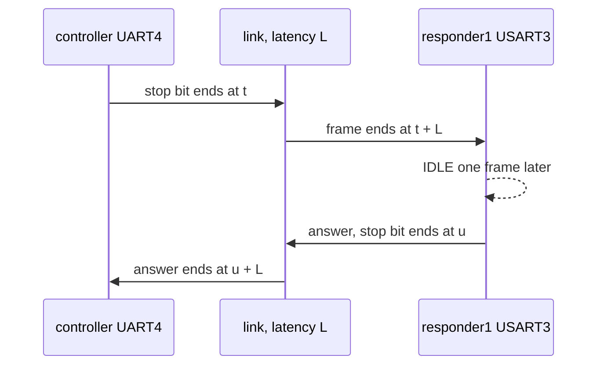

# Systems and links

A `popcorn.System` runs several machines on one virtual clock and links their UARTs. Each
machine, a member, has its own firmware. A byte one member sends on a UART arrives on the
other member's UART as the line would carry it, with a latency you choose.

## Describe a system

```python
--8<-- "guide/test_systems.py:describe"
```

- `members` maps a name to a `MachineDescription`. Two members may share one description.
- `UartLink("member.UART", "member.UART", latency=, baud=)` joins two UARTs in both directions.
  `latency` has no default, because it is part of the model, like a baud rate or a cable.
- `@popcorn.pytest.system` declares a fixture that hands each test a booted `System`. Every
  member boots from the boot snapshot of its own description, the one a machine fixture of that
  description uses, so the system adds no boot.

Without pytest, `SystemDescription.machines()` builds the machines, `boot_machine()` boots each
one, and `SystemDescription.link(machines)` returns the `System`. Call `system.close()` when done.

## Run it

```python
--8<-- "guide/test_systems.py:run"
```

`system.run(for_=)` runs every member until the system time has advanced. `system.members[name]`
is the member's `Machine`, so `var`, `periph`, `reg` and the hooks work as on a single machine.
A member's `Machine.time` counts from its own reset. `system.time_of(name)` gives its system
time, and `system.to_local()` and `system.to_system()` convert between the two.

A member that has no goal while another one runs one is halted. Its core executes nothing, and
its clocks, peripherals and DMA follow the system time. A goal's `budget` counts executed
instructions, so halted time does not use it up.

## Frames and latency



A frame whose stop bit ends at the sender at system time `t` ends at the receiver at exactly
`t + L`. Every hop adds `L`, so a request and its answer take `2 L` more than the firmware's own
time. The receiver's USART raises IDLE one frame after the last frame of a message.

The members meet every `Q` of system time, `Q` being the smallest latency of the system
and `system.quantum` its value. `Q` sets how often they meet, never what happens. The frames,
their times and every member's state are the same at any quantum, any slicing and any thread
timing.

## Tap a link

```python
--8<-- "guide/test_systems.py:tap"
```

`system.tap("member.UART")` names a link by either end. `tap.frames(towards=)` takes the frames
the tap holds in one direction, oldest first, each a `TapFrame` with its `data`, `start`, `end`
and `arrival` in system time. Reading never changes what the receiver gets.

A tap also edits the line:

- `tap.inject(data, at=, towards=)` puts frames on the line.
- `tap.replace(index, data, towards=)` gives the sender's frames from number `index` on new data,
  one frame per byte. `tap.drop(index, n, towards=)` keeps `n` frames off the line. Both raise
  `ValueError` for a frame that has started already. `TapFrame.index` is the number.
- `tap.posted(towards=)` gives the index of the next frame the sender starts.

## Pull the cable

```python
--8<-- "guide/test_systems.py:cut"
```

`tap.cut(start, end, line=)` cuts both directions over a window of system time. Times are system
times at the senders. Each receiver's line is cut over `[start + L, end + L)`.

- A frame starting inside the cut never reaches the receiver. The tap marks it `cut`.
- A frame crossing `start` or `end` is marked `cut` and `lost`. A frame crossing `start` reaches
  the receiver up to `start + L` only.
- `line="idle"`, the default, keeps the line high, so the receiver sees nothing and IDLE
  follows. `line="break"` holds it low, so the receiver gets one break character with a framing
  error.
- `tap.break_line()` opens a cut now and `tap.restore_line()` closes it. While the system runs,
  only a callback of the member `tap.owner` may call them, by default the member of the link's
  first end.

"Now" for a stopped system is the later of the two ends' `system.time_of`, as the test does.
Never use `system.time` for it, which depends on the quantum.

## Parked and running

A parked system runs only inside `system.run`. To react while the members run, use a free run:

```python
--8<-- "guide/test_systems.py:running"
```

Inside `system.running()` the members run whether the test awaits or not. A member's `elapse`,
`wait_for` and stream reads wait on the free run. A line edit such as `tap.replace` may be made
inside it.

Each member runs on its own native host thread, and the Python callbacks of different members
run at the same wall time. Keep callback state per member and couple members through links.
Shared Python state sees an order that depends on thread timing.

## Snapshot a system

```python
--8<-- "guide/test_systems.py:snapshot"
```

`system.snapshot()` takes every member and every link, frames in flight included.
`system.restore()` puts them back together. A member's own `snapshot()` and `restore()` raise
`MachineBusy`, so use the system's. A restored system replays the same frames.

The [linked_uart example](examples.md#serial-and-dma) runs a controller and two responders with
DMA, a watchdog reset of one member and a pulled cable.
