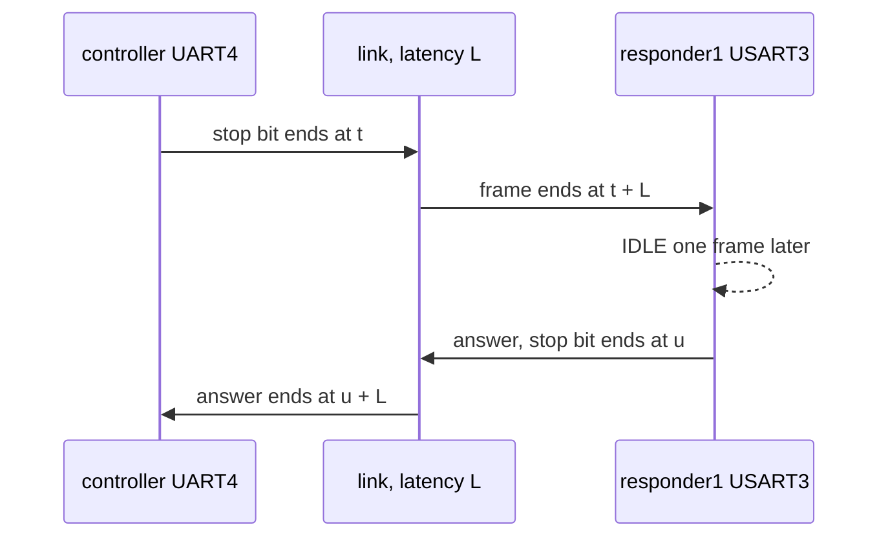

# Systems and links

A `popcorn.System` runs several machines on one virtual clock and links them over UART, SPI
and I2C. Each machine, a member, has its own firmware. A byte one member sends on a UART
arrives on the other member's UART as the line would carry it, with a latency you choose. An SPI
master clocks slaves on other members and an I2C controller addresses targets on other members,
each with the latency of its bus.

## Describe a system

```python
--8<-- "guide/test_systems.py:describe"
```

- `members` maps a name to a `MachineDescription`. Two members may share one description.
- `UartLink("member.UART", "member.UART", latency=, baud=)` joins two UARTs in both directions.
  `latency` has no default, because it is part of the model, like a baud rate or a cable.
  A frame whose baud or format differs from the link's is an error of a strict receiving member,
  dated at the frame's start at the sender. A frame can start before a barrier of the quantum
  by less than one sender instruction period and still be posted after it, because the sender's
  slice held at the barrier runs the events of the barrier's last instruction cycle in the next
  window. Its error is dated at the barrier.
- `@popcorn.pytest.system` declares a fixture that hands each test a booted `System`. Every
  member boots from the boot snapshot of its own description, the one a machine fixture of that
  description uses, so the system adds no boot.

In a script, `await SYSTEM.boot()` builds the machines, boots each one and links them, and
`system.close()` ends the system. `SystemDescription.machines()`, `boot_machine()` and
`link(machines)` are the three steps it runs.

## Run it

```python
--8<-- "guide/test_systems.py:run"
```

`system.run(for_=)` runs every member until the system time has advanced. `system.members[name]`
is the member's `Machine`, so `var`, `periph`, `reg` and the hooks work as on a single machine.
A member's `Machine.time` counts from its own reset. `system.time_of(name)` gives its system
time, and `system.to_local()` and `system.to_system()` convert between the two.

After a member stop at system time `P`, every other member that runs a goal and sleeps below
`P` stands at `P`: its `system.time_of(name)` is `P`. A member that ran past `P`, busy or asleep,
stands where it stopped, a position that depends on the quantum.

A member that has no goal while another one runs one is halted. Its core executes nothing, and
its clocks, peripherals and DMA follow the system time. A goal's `budget` counts executed
instructions, so halted time does not use it up.

## Frames and latency



A frame whose stop bit ends at the sender at system time `t` ends at the receiver at exactly
`t + L`. Every hop adds `L`, so a request and its answer take `2 L` more than the firmware's own
time. The receiver's USART raises IDLE one frame after the last frame of a message.

The members meet every `Q` of system time, `Q` being the smallest latency of the system
and `system.quantum` its value. Once the system runs on, what happens is the same at any
quantum, any slicing and any thread timing: the frames, their times and every member's state.
The one part that follows `Q` is what a parked action does at a TIME pause, since the events a
member has fired by that pause depend on the quantum. At such a pause these differ between
quanta:

- a register read, such as `ISR.TC` of a USART or the frames a stream holds
- a write of `UE = 0`, which cuts a frame in flight at one quantum and not at another
- an RCC peripheral reset pulse
- a parked `system.reset` of a member
- a member's `snapshot()` followed by `restore()`
- the bytes a member's `snapshot()` saves

Two runs at one quantum repeat exactly, whatever the slicing and the thread timing.

### Latency and wall time

Each window costs a fixed amount of wall time, whatever the link carries: every member ends its
slice at the barrier, waits for the others, then starts again. On a 16-CPU x86 host that is
about 2.6 us of wall time and 3.7 us of CPU per window for two members. A small `Q` multiplies
the windows, 1 / `Q` per virtual second.

Measured on two members, one busy a third of the time and one asleep most of the time, linked at
460800 baud, over 10 s of virtual time with a check every 10 ms:

| latency `L` | windows per virtual second | wall time |
|---|---|---|
| 5 us | 200 000 | 10.3 s |
| 10 us | 100 000 | 8.4 s |
| 20 us | 50 000 | 6.6 s |
| 50 us | 20 000 | 5.9 s |
| 100 us | 10 000 | 5.7 s |
| 500 us | 2 000 | 5.3 s |

Past about 100 us the members' own emulation sets the wall time. When the firmware's timing
does not depend on delays below some value, choose `L` at that value: a request and its answer
take `2 L`, so a protocol with millisecond timeouts runs the same at 50 us as at 5 us, in
57 percent of the wall time.

## Tap a link

```python
--8<-- "guide/test_systems.py:tap"
```

`system.tap("member.UART")` names a link by either end. `tap.frames(towards=)` takes the frames
the tap holds in one direction, oldest first, each a `TapFrame` with its `data`, `start`, `end`
and `arrival` in system time. Reading never changes what the receiver gets.

What the tap holds at a pause depends on the pause's kind:

- After a member stop, an IDLE pause or an error, it holds every frame ended by the pause point and
  no later one, whatever the quantum, the slicing or the wall timing.
- After a TIME stop or a requested pause, it holds the frames ended by the earliest member's
  position, which can lie before the pause point by an amount that depends on the quantum. The
  rest follow at the next pause or at `close()`.
- While the system runs, a read can lag the latest frames by up to two windows of the quantum
  behind the receiving member's time. Before a free run sleeps, the tap shows every frame ended
  by the earliest member's position, so a host polling the tap while the system sleeps sees
  those frames. A read at a pause is complete as above.

A tap also edits the line:

- `tap.inject(data, at=, towards=)` puts frames on the line. Stopped or paused, an overlap with a
  frame already on the receiver's line raises `ValueError` at the call. While the system runs,
  the overlap stops the system with an error at a time the frames fix: the later frame's start
  for two injected frames, and the later of the injected frame's start and the peer frame's
  sender start for an injected frame and a peer frame. The error is the receiving member's.
- `tap.replace(index, data, towards=)` gives the sender's frames from number `index` on new data,
  one frame per byte. `tap.drop(index, n, towards=)` keeps `n` frames off the line. Both raise
  `ValueError` for a frame that has started already. `TapFrame.index` is the number.
- `tap.posted(towards=)` gives the index of the next frame the sender starts.

## Pull the cable

```python
--8<-- "guide/test_systems.py:cut"
```

`tap.cut(start, end, line=)` cuts both directions over a window of system time. Times are system
times at the senders. Each receiver's line is cut over `[start + L, end + L)`.

- A frame starting inside the cut never reaches the receiver. The tap marks it `cut`.
- A frame crossing `start` or `end` is marked `cut` and `lost`. A frame crossing `start` reaches
  the receiver up to `start + L` only.
- `line="idle"`, the default, keeps the line high, so the receiver sees nothing and IDLE
  follows. `line="break"` holds it low, so the receiver gets one break character with a framing
  error.
- `tap.break_line()` opens a cut now and `tap.restore_line()` closes it. While the system runs,
  only a callback of the member `tap.owner` may call them, by default the member of the link's
  first end.
- `tap.owner` is readable from any callback of a member. It raises `EmulationError` once the
  system is closed.

"Now" for a stopped system is the later of the two ends' `system.time_of`, as the test does.
Never use `system.time` for it, which depends on the quantum.

## Parked and running

A parked system runs only inside `system.run`. To react while the members run, use a free run:

```python
--8<-- "guide/test_systems.py:running"
```

Inside `system.running()` the members run whether the test awaits or not. A member's `elapse`,
`wait_for` and stream reads wait on the free run. A line edit such as `tap.replace` may be made
inside it.

Each member runs on its own native host thread, and the Python callbacks of different members
run at the same wall time. Keep callback state per member and couple members through links.
Shared Python state sees an order that depends on thread timing.

## SPI buses

```python
--8<-- "guide/test_systems.py:spi"
```

`SpiBus(master=, slaves=, latency=)` joins the SPI of one member to the SPI of each slave
member. `slaves` maps the master's chip select to the slave's SPI: `"a.PA4"` is a GPIO pin of
the master that selects the slave while low, `"a.NSS"` is the master's SS output. The master
member runs its SPI as it does with a board device per slave, and keeps its own board devices on
the same SPI. The slave members run their SPI in target mode, with no board controller and no
board device on it. A master drives at most one slave through its SS output.

A frame the master finishes at system time `t` is clocked by the slave over
`[t + L, t + L + fp]`, with `fp` the frame time. The slave's reply is stamped `t + L + fp` and
completes the master's frame at `t + 2 L + fp`. A chip select edge reaches the slave `L` after the
master drove it. SCK stays idle from a frame's end to its completion, `2 L + fp` later, and the
next frame starts at the completion when the TX FIFO holds it. The frame ends of a transfer are
at least `2 L + 2 fp` apart and `n` frames take at least `n * (2 L + 2 fp)`, which is `2 L + fp`
more per frame than on a board. The firmware's own work between two frames adds to the spacing.

A frame the slave never clocks completes with all ones at the master. A reset of the slave
drops the frames it has not clocked, and a deselect cuts a frame in flight.

`system.tap("a.SPI1", popcorn.SpiTap)` names the bus by any of its ends. `tap.frames()` takes
the `SpiTapFrame`s the tap holds, oldest first, each with its slave, chip select pin, `mosi`,
`miso`, `bits`, the master's frame end `at`, the slave's `reply` stamp and whether it was
`dropped`. A frame's content does not depend on the quantum, the slicing or the thread timing.
The tap keeps up to 1 Mi frames not read yet and counts the older ones in `tap.dropped`.

## I2C buses

```python
--8<-- "guide/test_systems.py:i2c"
```

`I2CBus(ports=, latency=)` joins the I2C of the controller member, listed first, to the I2C of
each target member. The controller's I2C runs as it does with a board target per remote target,
and keeps its own board targets on the same I2C. The target members run their I2C in target
mode, with no board controller and no board target on it. The firmware of a target member
configures OAR1, OAR2 or the general call as on a board, and the address match is decided there.

An address phase, a written byte or a read byte the controller ends at system time `t` is
replayed by each target over `[t + L, t + L + p]`, with `p` the phase as the controller clocked
it. A target answers at `t + L + p + s`, `s` being its clock stretch, and the controller's phase
completes `L` after the last answer. SCL stays low for `2 L + p + s` per phase, which is
`2 L + p` more per phase than the same transfer on a board, where it stays low for `s`. Two byte
phases of a transfer end `2 L + 2 p` apart when no target stretches.

- Targets on one address answer together as the open-drain bus combines them: the address or
  written byte is acknowledged when any target acknowledges it, read bytes are the AND of the
  targets' bytes, and the phase waits for the longest stretch. A local board target on the
  controller's I2C takes part, and the controller waits for the remote answers.
- A written or read byte reaches only the targets that acknowledged the transfer's last address.
- A STOP reaches the targets `L` after the controller drove it.
- A phase a target never answers gets the undriven reply: NACK for an address or a written byte,
  `0xFF` for a read byte. A reset of the target drops its unanswered phases and a STOP cuts a
  phase in flight.

The SMBus timeouts follow the longer phases. The controller's I2C trips TIMEOUT when
`2 L + p + s` reaches the firmware's TIMEOUTA, so a transfer that runs in time on a board can trip
TIMEOUT on the controller's I2C across a bus with a large `L`. Only a target the transfer addressed
counts SCL low from the end of each phase to the start of the next phase or STOP the controller
queued, the remote waits included, until a reset of the controller's I2C releases the bus.

`system.tap("a.I2C1", popcorn.I2CTap)` names the bus by any of its ends. `tap.phases(target=)`
takes the `I2CTapPhase`s the tap holds, oldest first, one per target and phase, each with its
`target`, `phase` as an `I2CPhase`, `unit`, `byte`, `ack`, the controller's phase
end `at`, the target's `answer` stamp and whether it was `dropped`. An address phase gives a
record per target, a byte phase one per target that acknowledged the address. The tap keeps up to
1 Mi phases not read yet and counts the older ones in `tap.dropped`.

### A host controller on one machine

A single machine whose firmware runs its I2C in target mode is tested with
`popcorn.board.I2CController`, a Python controller outside the MCU on the I2C:

```python
--8<-- "guide/test_systems.py:controller"
```

`start`, `write`, `read` and `stop` queue phases at the clock of `scl_hz`. Each phase gets one
`I2CAnswer` in `host.answers`, the undriven reply when the I2C drops it. A target that stretches
SCL holds the phases after it.

## Buses and taps

- A UART, an SPI or an I2C belongs to one link or bus. The targets of a bus are on members
  other than the controller's.
- Every link and bus declares its latency. `system.quantum` is the smallest of them, and the
  results of every medium are the same at any quantum, slicing and thread timing, except for
  what a parked action does at a TIME pause, see above.
- `system.tap(end, kind)` takes `UartTap`, `SpiTap` or `I2CTap`. The tap of any end of a bus is
  the same object.

## Snapshot a system

```python
--8<-- "guide/test_systems.py:snapshot"
```

`system.snapshot()` takes every member and every link and bus, frames, frames of an SPI transfer
and phases of an I2C transfer in flight included. `system.restore()` puts them back together. A
member's own `snapshot()` and `restore()` raise `MachineBusy`, so use the system's. A restored
system replays the same frames, SPI frames and I2C phases. A restore discards what the taps hold
and restarts their `dropped` counts.

The [linked_uart example](examples.md#serial-and-dma) runs a controller and two responders with
DMA, a watchdog reset of one member and a pulled cable.
